# tm — Test Memoization Utility

## Technical Specification

**Status:** Draft  
**Target implementation:** C, Linux-first  
**Primary purpose:** Language-agnostic memoization of successful test and verification commands  
**Invocation model:**

```bash
tm -- <test command>
```

Examples:

```bash
tm -- pytest tests/test_risk.py
tm -- go test ./pkg/risk
tm -- cargo test risk_score
tm -- ./gradlew test
tm -- ./tests/test_import.sh
tm -- ./build/unit_tests
```

---

# 1. Purpose

`tm` is a small, language-agnostic command-line utility that reduces unnecessary repeated test execution.

It runs an arbitrary test command, observes the files and execution context used by that command, records the resulting dependency fingerprint and process exit code, and reuses a previous successful result when the effective inputs have not changed.

The fundamental invariant is:

> If the command, its relevant inputs, and its execution environment are unchanged from a previous successful execution, rerunning the same deterministic test provides no additional information.

`tm` therefore treats a successful test execution as a reusable verification result.

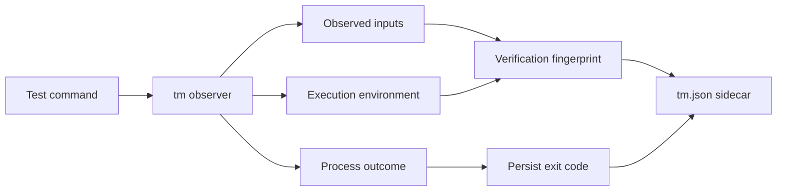

---

# 2. Goals

`tm` MUST:

1. Execute arbitrary test commands.
2. Determine success or failure from the actual child process outcome.
3. Observe runtime filesystem dependencies of the command and its descendants.
4. Persist dependency metadata beside the test source in a `tm.json` sidecar.
5. Hash relevant repository-controlled inputs using SHA-256.
6. Skip tests whose complete verification fingerprint matches a previously successful execution.
7. Return the same successful exit code to the caller when a test is skipped.
8. Preserve the original exit status when a test actually runs.
9. Work consistently across developer machines and CI/CD pipelines.
10. Allow sidecars to be committed to Git.
11. Ensure changes to `tm` metadata do not themselves invalidate application tests.
12. Ensure sidecar-only changes do not trigger repository-wide testing.
13. Default to rerunning whenever `tm` cannot establish that reuse is safe.
14. Be implemented as a small native utility, initially targeting Linux.
15. Require no changes to the test code itself.

---

# 3. Non-goals

The initial implementation MUST NOT attempt to:

- replace pytest, JUnit, Go Test, Cargo Test, Gradle, or other test frameworks;
- become a general-purpose build system;
- build a complete static dependency graph of the repository;
- understand source-code semantics;
- automatically determine database row-level dependencies;
- treat arbitrary external network state as cacheable;
- infer whether nondeterministic tests are logically safe to cache;
- replace CI orchestration;
- persist reusable failed results;
- determine individual test-case results inside a multi-test command unless an optional adapter provides those boundaries.

---

# 4. Core Model

A reusable verification result is defined by:

```text
verification =
    command
  + test identity
  + repository input state
  + declared environment state
  + execution semantics
```

The result of an actual execution is:

```text
verification fingerprint -> process outcome
```

Only a normal successful process exit is reusable.

For version 1:

```text
exit_code == 0
```

means that the execution is eligible for reuse.

A previous non-zero exit code MUST NOT cause the next invocation to be skipped.

---

# 5. High-Level Execution Flow

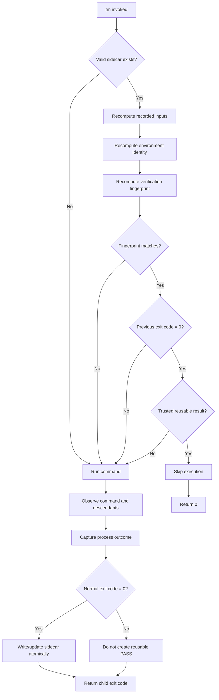

---

# 6. Repository Root

`tm` SHOULD determine the repository root using, in order:

1. explicit `--root`;
2. closest parent containing `.git`;
3. current working directory.

All repository-controlled paths written to metadata MUST be relative to this root.

Absolute user-specific paths MUST NOT be persisted.

---

# 7. Sidecar Location

Where there is an obvious primary test script:

```text
tests/test_risk.py
```

the preferred layout is:

```text
tests/
├── test_risk.py
└── .tm/
    └── test_risk.py.tm.json
```

The `.tm/` directory SHOULD be adjacent to the test file rather than scattering sidecar files throughout the ordinary source listing.

Where the command has no obvious primary test file, `tm` MAY store command-level state under the repository root:

```text
.tm/
└── commands/
    └── <command-id>.tm.json
```

The sidecar path MUST NOT contribute to the verification fingerprint.

---

# 8. Sidecar Format

The sidecar MUST use deterministic JSON.

Example:

```json
{
  "schema_version": 1,
  "tm_semantics_version": 1,

  "identity": {
    "command": [
      "pytest",
      "tests/test_risk.py"
    ],
    "working_directory": ".",
    "command_fingerprint": "sha256:..."
  },

  "inputs": [
    {
      "path": "tests/test_risk.py",
      "kind": "file",
      "sha256": "..."
    },
    {
      "path": "src/risk/scoring.py",
      "kind": "file",
      "sha256": "..."
    },
    {
      "path": "config/risk.yaml",
      "kind": "file",
      "sha256": "..."
    }
  ],

  "environment": {
    "platform": "linux-x86_64",
    "runtime_identity": "..."
  },

  "verification_fingerprint": "sha256:...",

  "result": {
    "exit_code": 0,
    "signal": null
  }
}
```

The sidecar MUST NOT contain volatile information such as:

- timestamp;
- hostname;
- username;
- PID;
- temporary paths;
- arbitrary execution duration;
- CI pipeline ID;
- branch name.

Such information would create unnecessary Git churn.

Diagnostic information MAY be written separately but MUST NOT affect the reusable sidecar state.

---

# 9. Process Outcome

The authoritative result MUST be the actual child-process outcome.

Normal completion:

```json
{
  "exit_code": 0,
  "signal": null
}
```

Failure:

```json
{
  "exit_code": 1,
  "signal": null
}
```

Signal termination:

```json
{
  "exit_code": null,
  "signal": 11
}
```

`tm` MUST NOT persist a second authoritative status such as:

```text
PASS
FAIL
SUCCESS
ERROR
```

These states MAY be derived for display.

Interpretation:

```text
exit_code == 0       successful
exit_code != 0       unsuccessful
terminated by signal unsuccessful
```

---

# 10. Exit-Code Transparency

When a test actually executes, `tm` MUST preserve its observable exit behavior.

```text
pytest exits 0
-> tm records exit_code=0
-> tm exits 0
```

```text
pytest exits 2
-> tm records exit_code=2
-> tm exits 2
```

When a successful result is reused:

```text
matching trusted fingerprint
+ previous exit_code = 0

-> test is not executed
-> tm exits 0
```

This allows existing CI systems to use `tm` without special integration.

---

# 11. Input Discovery

`tm` MUST discover inputs dynamically by observing execution of the command and its descendants.

The test itself does not need to declare its dependencies.

The first execution acts as discovery.

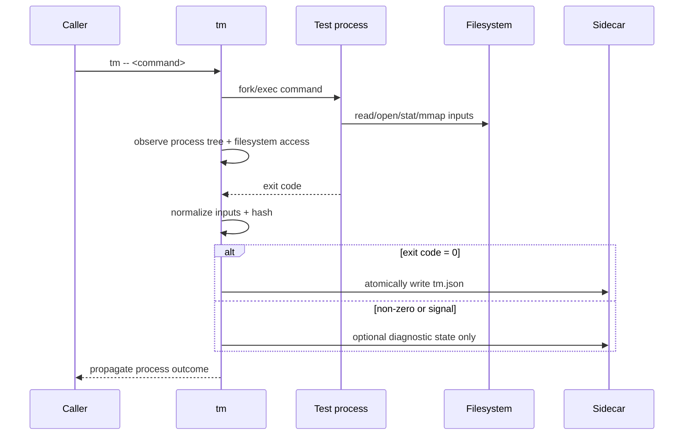

---

# 12. Process-Tree Tracking

`tm` MUST observe the complete process tree descended from the launched command.

It MUST account for processes created via mechanisms such as:

```text
fork()
vfork()
clone()
clone3()
execve()
execveat()
posix_spawn()
```

Example:

```text
tm
└── pytest
    └── python
        ├── helper
        └── shell
            └── executable
```

Inputs accessed by all descendants MUST be considered part of the execution unless excluded by policy.

---

# 13. Filesystem Dependency Types

`tm` SHOULD distinguish several kinds of filesystem dependency.

## 13.1 File-content dependency

Example:

```text
open("config/rules.yaml")
read(...)
```

Persist:

```json
{
  "path": "config/rules.yaml",
  "kind": "file",
  "sha256": "..."
}
```

## 13.2 File-existence dependency

Example:

```python
if Path("feature.flag").exists():
```

Persist something equivalent to:

```json
{
  "path": "feature.flag",
  "kind": "exists",
  "state": false
}
```

## 13.3 Directory-membership dependency

Example:

```python
os.listdir("schemas/")
```

The names in the directory may affect behavior even when files are not subsequently opened.

`tm` SHOULD represent directory membership deterministically, for example by hashing a sorted list of relevant entries.

## 13.4 Symlink dependency

If a symlink determines which file is read, both the link target and resulting file contents MAY be relevant.

---

# 14. Relevant Linux Operations

The initial Linux implementation SHOULD consider at minimum observations corresponding to:

```text
open
openat
openat2
read
pread
mmap
stat
fstat
newfstatat
access
faccessat
readlink
readlinkat
getdents
getdents64
execve
execveat
```

The exact observation mechanism is an implementation decision.

Candidates include:

- `ptrace`;
- seccomp-based notification;
- eBPF;
- `LD_PRELOAD`;
- filesystem namespace/sandbox observation.

The first implementation SHOULD favor correctness and maintainability over maximum performance.

---

# 15. Input Classification

Not every observed file SHOULD become an individually hashed input.

Inputs MUST be classified.

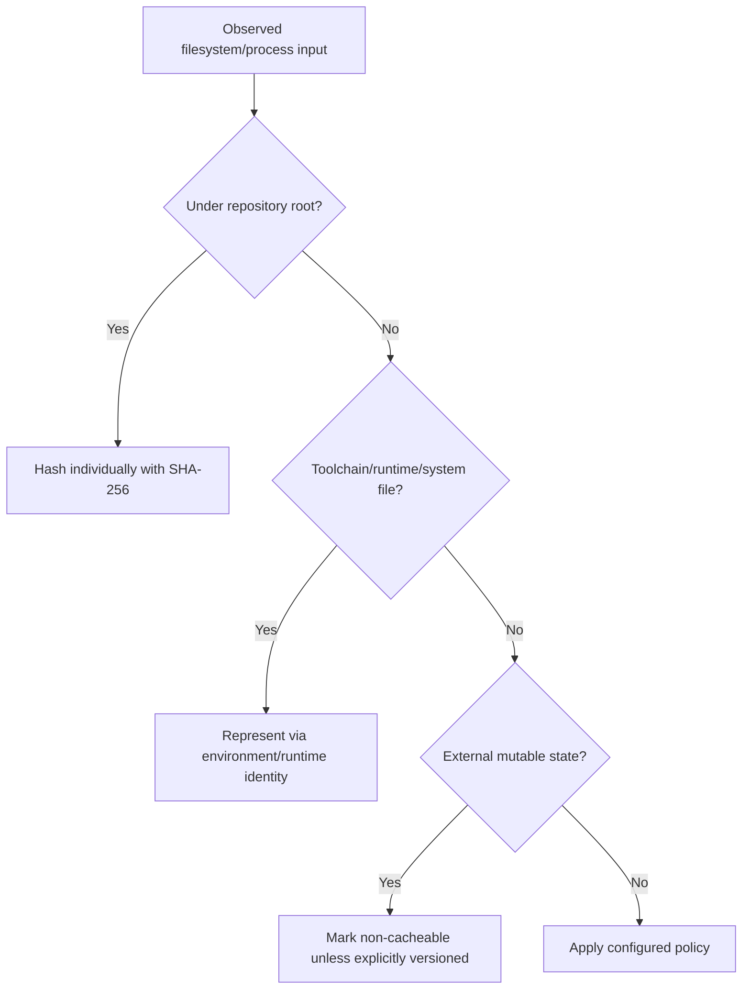

## 15.1 Repository-controlled files

Files under the repository root SHOULD generally be fingerprinted individually.

Examples:

```text
src/foo.py
tests/test_foo.py
fixtures/entity.json
config/rules.yaml
Cargo.toml
go.mod
```

## 15.2 System files

Files under locations such as:

```text
/usr/lib/*
/usr/share/*
/lib/*
```

SHOULD NOT normally be individually persisted in every sidecar.

Instead they SHOULD be represented by an execution-environment identity.

## 15.3 Toolchain

The compiler/interpreter/toolchain SHOULD be represented using a stable environment identity such as:

```text
Python version
Go version
Rust toolchain version
JDK version
container image digest
```

Where CI runs tests inside a container, the OCI image digest SHOULD be preferred.

---

# 16. Test Source Is Always an Input

The primary test source MUST always contribute to the verification fingerprint, regardless of whether runtime observation detects it being read.

Similarly, command arguments and execution semantics MUST contribute to the fingerprint.

---

# 17. Command Identity

The following commands MUST be considered different:

```bash
pytest tests/test_foo.py
pytest -x tests/test_foo.py
```

Likewise:

```bash
cargo test foo
cargo test foo --release
```

`tm` MUST canonicalize and fingerprint:

- executable;
- arguments;
- working directory;
- execution-relevant options.

Internally, commands SHOULD be represented as argument vectors rather than flattened strings.

---

# 18. Verification Fingerprint

The verification fingerprint SHOULD be computed from a deterministic canonical representation containing at least:

```text
tm semantics version
command identity
working directory
test source
observed repository inputs
declared additional inputs
environment identity
```

Conceptually:

```text
verification_fingerprint =
    SHA256(
        canonical(
            tm_semantics_version,
            command,
            working_directory,
            sorted_inputs,
            environment_identity
        )
    )
```

Individual input hashes MUST remain available in the sidecar for diagnostics even if the aggregate fingerprint is sufficient for the skip decision.

---

# 19. Skip Decision

`tm` MAY skip execution only when all of the following are true:

1. a valid sidecar exists;
2. its schema version is understood;
3. its test/command identity matches;
4. its previous execution exited normally;
5. its previous exit code was `0`;
6. every recorded input remains equivalent;
7. the execution environment identity remains equivalent;
8. no policy condition requires forced execution;
9. the sidecar satisfies applicable provenance/trust requirements.

Otherwise:

```text
RUN
```

MUST be the default.

---

# 20. Failed Tests

Failed results MUST NOT be reusable for skipping.

A previous non-zero exit code may remain in the sidecar for diagnostics, but the next invocation MUST execute again.

Principle:

> A successful proof may be reusable. A failed execution is never proof of continued failure.

---

# 21. Relearning Dependencies

Whenever a test actually executes, `tm` MUST rebuild its observed dependency set.

Example:

Previous execution:

```text
test
-> foo.py
-> bar.py
```

New `foo.py` introduces:

```text
new_module.py
```

Because `foo.py` changed, the previous verification is invalidated. The test runs and `tm` relearns:

```text
test
-> foo.py
-> bar.py
-> new_module.py
```

This allows the dependency set to evolve naturally.

---

# 22. Metadata Exclusion

`tm` metadata MUST NEVER become a dependency of ordinary test execution.

At minimum, the following SHOULD be globally excluded:

```text
**/.tm/**
**/*.tm.json
```

This prevents a self-invalidating loop.

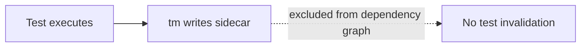

`tm` SHOULD ignore its own state before applying any generic input-tracking rules.

---

# 23. Git and CI Behavior

Sidecars are intended to be committed to Git.

This allows successful dependency knowledge to travel between:

- developers;
- branches;
- CI pipelines;
- clean environments.

However, changes consisting exclusively of `tm` metadata MUST NOT trigger broad test execution.

Repository CI SHOULD classify:

```text
**/.tm/**
```

as verification metadata.

A sidecar-only change SHOULD produce:

```text
tm validate
```

rather than normal application testing.

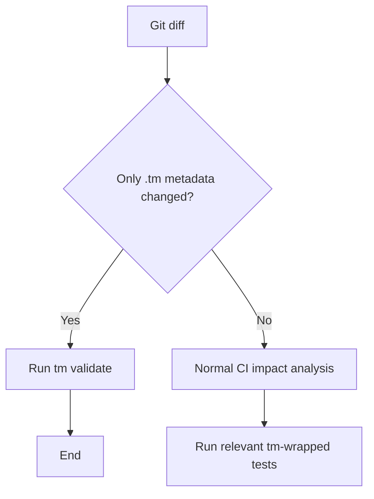

---

# 24. `tm validate`

`tm` SHOULD provide:

```bash
tm validate
```

This command MUST validate sidecars without executing represented tests.

Checks SHOULD include:

- valid JSON;
- supported schema version;
- valid SHA-256 syntax;
- valid relative paths;
- no path traversal;
- no absolute paths;
- deterministic structure;
- no secret-bearing fields;
- no forbidden metadata;
- valid process-result structure;
- optional provenance verification.

---

# 25. Trust and Provenance

Committed verification state creates a security issue.

A contributor MUST NOT be able to forge a sidecar that causes CI to skip an unverified change.

Dependency metadata and verification trust MUST therefore be considered separately.

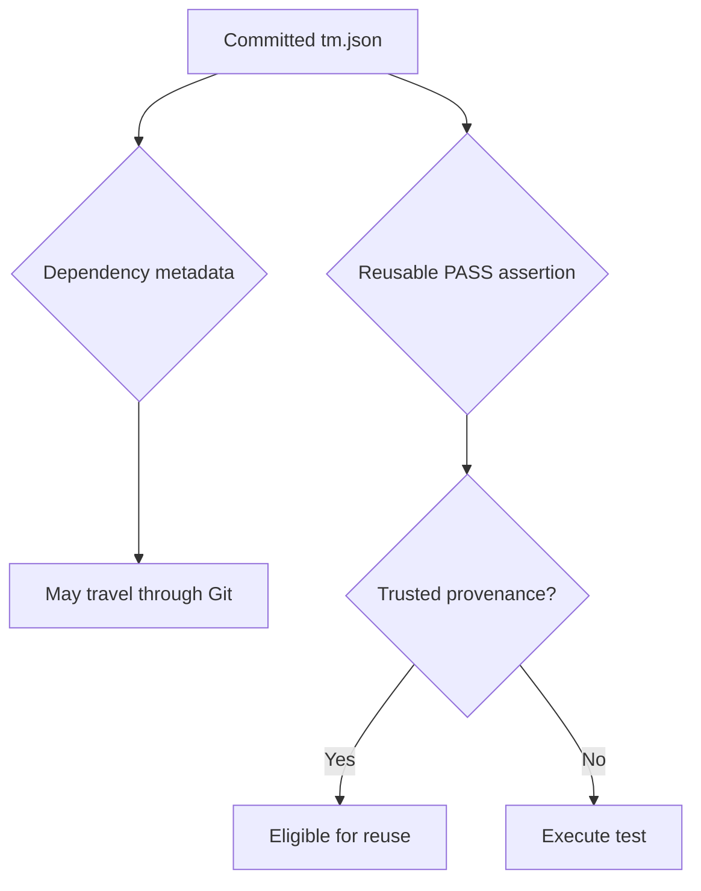

The assertion:

```text
fingerprint ABC was successfully verified
```

SHOULD have provenance.

---

# 26. Initial Provenance Model

The recommended initial model is a **trusted-baseline model**.

A successful sidecar is trusted for CI reuse only when it descends from an accepted verification state on a protected branch.

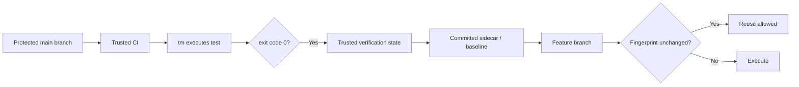

A feature branch MUST NOT establish trusted PASS state merely by editing JSON.

The exact trust mechanism MAY initially rely on CI policy rather than embedded signatures.

---

# 27. Optional Signed Attestations

A future version MAY sign:

```text
verification fingerprint
exit code
tm semantics version
environment identity
```

using a CI-controlled key.

Example:

```json
{
  "attestation": {
    "verification_fingerprint": "sha256:...",
    "exit_code": 0,
    "issuer": "trusted-ci",
    "signature": "..."
  }
}
```

This is not required for the MVP.

---

# 28. External Network State

Network access MUST be treated conservatively.

If the test or a descendant opens an external network connection and no stable external-state identity has been declared, the execution SHOULD become non-reusable.

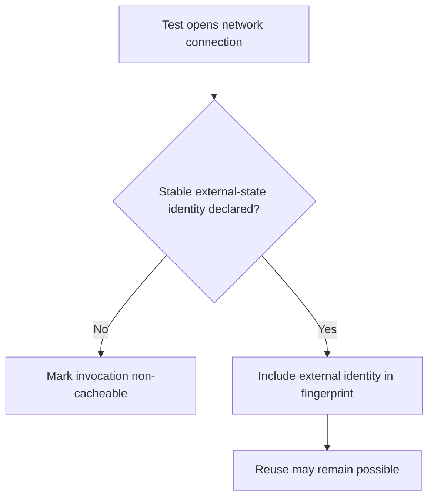

A connection to PostgreSQL, Redis, Kafka, HTTP, S3, or another service does not by itself identify the data that affected the result.

---

# 29. Declared External Inputs

The command SHOULD allow callers to provide additional logical inputs.

Example:

```bash
tm \
  --external-input db-fixture=sha256:abc123 \
  -- pytest tests/integration/test_customer.py
```

or:

```bash
tm \
  --input migrations/schema.sql \
  -- pytest ...
```

Such values MUST contribute to the verification fingerprint.

---

# 30. Environment Variables

Environment variables can influence test results.

`tm` MUST NOT serialize environment variable values into committed metadata.

Version 1 SHOULD support explicitly declared environment dependencies:

```bash
tm --env-input FEATURE_MODE -- pytest ...
```

The sidecar SHOULD record only a cryptographic hash of the value.

Automatic observation of environment access MAY be added later.

---

# 31. Time and Randomness

Sources such as:

```text
current wall-clock time
random number generators
/dev/random
/dev/urandom
```

can make tests nondeterministic.

Version 1 SHOULD adopt a conservative policy.

If such a dependency is reliably detected and is not controlled by the test environment, `tm` SHOULD mark the invocation non-cacheable.

---

# 32. Generic Command Granularity

Without framework-specific integration:

```bash
tm -- pytest tests/
```

represents one verification command.

Its sidecar means:

> The entire command completed successfully with these observed inputs.

Likewise:

```bash
tm -- go test ./...
```

is one cache unit.

This is sufficient for the generic implementation.

---

# 33. Optional Framework Adapters

Future adapters MAY improve granularity.

Examples:

- pytest;
- JUnit;
- Go test;
- Cargo test.

Adapters could notify `tm` of individual test boundaries:

```text
TEST_START identifier
TEST_END identifier result
```

The low-level dependency observer remains generic.

Adapters SHOULD only supply:

- test identity;
- start boundary;
- end boundary;
- optional framework result metadata.

They SHOULD NOT implement a separate dependency-discovery mechanism.

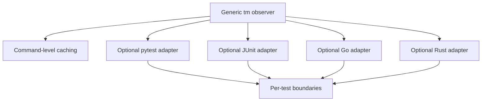

---

# 34. CLI

Minimum supported commands:

```bash
tm -- <command>
tm --force -- <command>
tm --explain -- <command>
tm validate
tm clean
```

---

# 35. `tm --force`

Example:

```bash
tm --force -- pytest tests/test_foo.py
```

MUST execute the command regardless of cached state.

After execution, `tm` SHOULD rebuild the sidecar normally.

An environment variable SHOULD also be supported:

```bash
TM_FORCE=1
```

Use cases:

- debugging;
- nightly exhaustive testing;
- cache-validation runs;
- confidence checks;
- investigating suspected false skips.

---

# 36. `tm --explain`

`tm` SHOULD explain its decision.

Example skip:

```text
SKIP tests/test_score.py

Reason:
  previous successful verification fingerprint matches

Fingerprint:
  sha256:8a84...
```

Example execution:

```text
RUN tests/test_score.py

Reason:
  src/risk/scoring.py changed

Previous:
  sha256:abc123...

Current:
  sha256:def456...
```

Other possible reasons include:

```text
no sidecar
command changed
test file changed
environment changed
external network dependency
previous execution failed
sidecar untrusted
tm semantics changed
forced execution
```

---

# 37. `tm clean`

```bash
tm clean
```

SHOULD remove generated `tm` state.

Deletion of all sidecars MUST NEVER harm correctness.

The consequence is only that tests execute again and regenerate state.

---

# 38. Sidecar Write Semantics

Sidecars MUST be written atomically.

Recommended pattern:

```text
write temporary file
fsync where appropriate
rename into place
```

An interrupted process MUST NOT leave a partially valid sidecar that could later cause a false skip.

The sidecar SHOULD only become reusable after the child command has completed successfully.

---

# 39. Concurrency

Multiple processes MAY attempt to run or update the same test concurrently.

`tm` MUST avoid corrupting sidecar state.

The implementation SHOULD use an advisory lock or equivalent mechanism.

The MVP MAY allow a second runner to execute independently but MUST serialize writes safely.

A later optimization MAY permit the second runner to wait for the first and reuse its newly created result.

---

# 40. SHA-256

SHA-256 MUST be the standard content hash for version 1.

Format:

```text
sha256:<hex>
```

Hash algorithms MAY become versioned later.

---

# 41. Performance

`tm` only provides value if:

```text
cost of checking inputs << cost of rerunning tests
```

Potential future optimizations include:

- cache file hashes using inode/mtime/size;
- parallel hashing;
- repository-level content index;
- reuse Git object hashes where safe;
- aggregate directory fingerprints;
- memory-mapped metadata database.

These optimizations MUST NOT weaken correctness.

The initial implementation MAY hash all recorded repository inputs directly.

---

# 42. Git Optimization

Tracked repository files already participate in Git object identity.

A future implementation MAY use Git information to accelerate change detection.

However, the canonical `tm` verification state SHOULD remain explicitly defined rather than implicitly depending on Git implementation details.

Git SHOULD be treated as an optimization source, not the trust model.

---

# 43. Sidecar Changes and Test Impact Analysis

Any repository-wide impact analyzer MUST explicitly classify:

```text
**/.tm/**
```

as non-application metadata.

Changing:

```text
tests/risk/.tm/test_score.py.tm.json
```

MUST NOT imply:

```text
risk code changed
```

nor:

```text
rerun every test
```

The normal reaction is:

```text
validate sidecar
```

This rule applies to:

- GitLab `rules:changes`;
- Pants target inference;
- custom impact analyzers;
- repository automation;
- agent workflows.

---

# 44. Self-Invalidation Prevention

`tm` MUST ensure that writing or reading its own metadata does not modify the verification fingerprint.

The observer MUST distinguish:

```text
tm supervisor activity
```

from:

```text
child process activity
```

---

# 45. Sandbox Integration

The initial implementation may operate as an observer only.

A later version SHOULD support optional sandboxing:

```bash
tm --sandbox -- pytest ...
```

Possible mechanisms include:

- mount namespaces;
- user namespaces;
- temporary filesystem overlays;
- restricted network namespaces.

Sandboxing can improve correctness by exposing hidden dependencies.

---

# 46. CI Integration

Example GitLab job:

```yaml
unit-tests:
  script:
    - tm -- pytest tests/unit/
```

If nothing relevant changed:

```text
tm loads trusted sidecar
-> validates fingerprint
-> skips pytest
-> exits 0
```

If an input changed:

```text
tm invalidates result
-> executes pytest
-> records dependencies
-> exits with pytest exit code
```

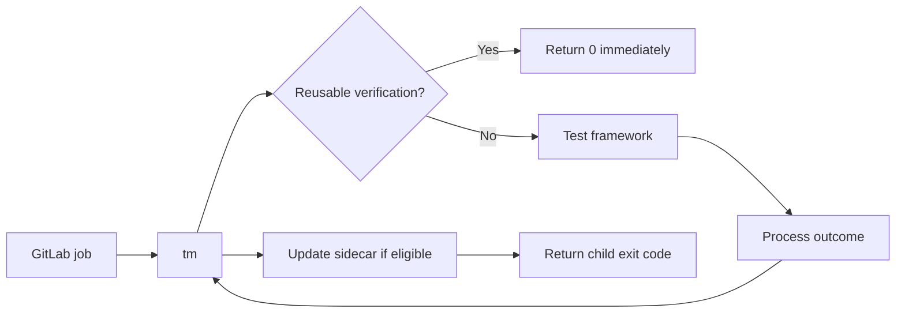

No special CI protocol is required.

---

# 47. Exhaustive Validation CI

Repositories adopting `tm` SHOULD continue running periodic exhaustive tests.

Example:

```yaml
nightly-full-tests:
  variables:
    TM_FORCE: "1"
  script:
    - tm -- pytest tests/
```

This provides a backstop against:

- missing dependencies;
- observer bugs;
- unexpected nondeterminism;
- previously unknown environmental inputs.

False skips discovered during exhaustive runs SHOULD drive improvements to `tm` dependency semantics.

---

# 48. Recommended Validation Modes

## Normal MR

```text
tm caching enabled
```

Goal: fast developer feedback.

## Main branch

```text
tm caching enabled
```

Goal: verify affected state efficiently.

## Nightly

```text
TM_FORCE=1
```

Goal: exhaustive regression.

## Release qualification

Policy-dependent:

```text
TM_FORCE=1
```

or stricter verification profile.

---

# 49. Safety Principle

The central safety rule is:

> When uncertain, execute.

Examples that SHOULD force execution:

```text
unknown sidecar version
malformed metadata
missing recorded input
ambiguous environment
untrusted verification state
uncontrolled network dependency
unsupported filesystem operation affecting input discovery
hashing failure
observer failure
```

`tm` is an optimization layer.

It MUST fail toward more testing rather than less testing.

---

# 50. Logging

Normal operation SHOULD be terse.

Example:

```text
tm: SKIP tests/test_score.py [cached successful verification]
```

or:

```text
tm: RUN tests/test_score.py [src/risk.py changed]
```

Verbose mode MAY expose dependency details.

Secrets MUST never be printed or persisted.

---

# 51. Return-Code Handling

`tm` itself may encounter errors before the child command runs.

The application SHOULD reserve clearly documented exit codes for internal errors.

Suggested conventions:

```text
125 = tm internal error
126 = command found but cannot execute
127 = command not found
```

A child-process exit code MUST otherwise pass through unchanged.

---

# 52. MVP Scope

Version 0.1 SHOULD implement only:

1. Linux support.
2. C implementation.
3. Command wrapper.
4. Process-tree tracking.
5. Repository file-read observation.
6. SHA-256 file hashing.
7. Deterministic JSON sidecars.
8. Successful exit-code caching.
9. Forced execution.
10. Explain mode.
11. Metadata exclusion.
12. Sidecar validation.
13. Conservative network detection.
14. Basic environment identity.
15. Git-portable relative paths.

Version 0.1 SHOULD NOT attempt:

- individual pytest test boundaries;
- JUnit adapters;
- eBPF optimization unless needed;
- remote cache services;
- distributed locking;
- signed attestations;
- Windows support;
- macOS support;
- database-content tracking;
- automatic environment-variable interception.

---

# 53. Suggested Internal Architecture

```text
main.c
├── cli.c
├── repo.c
├── command.c
├── observer.c
│   ├── process tracking
│   └── filesystem events
├── dependencies.c
├── sha256.c
├── fingerprint.c
├── sidecar.c
├── policy.c
└── explain.c
```

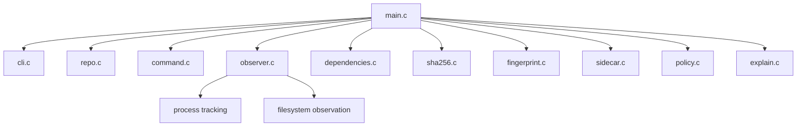

Responsibilities MUST remain separated.

The observation backend SHOULD be abstracted enough that a `ptrace` implementation can later be replaced or complemented by eBPF, seccomp, or sandbox-based observation without changing sidecar semantics.

---

# 54. Example Lifecycle

Initial repository:

```text
src/foo.py
tests/test_foo.py
```

Developer runs:

```bash
tm -- pytest tests/test_foo.py
```

Observed:

```text
tests/test_foo.py
src/foo.py
src/common.py
```

pytest exits:

```text
0
```

`tm` writes:

```text
tests/.tm/test_foo.py.tm.json
```

and exits `0`.

A second developer clones the repository and executes:

```bash
tm -- pytest tests/test_foo.py
```

If command, environment, test, inputs, and trust state all match, pytest does not execute and `tm` returns `0`.

If `src/foo.py` changes:

```text
foo.py hash differs
-> previous verification invalid
-> pytest executes
-> dependencies relearned
-> new sidecar written
```

---

# 55. Example Explain Output

```text
$ tm --explain -- pytest tests/test_risk.py

RUN pytest tests/test_risk.py

Previous verification:
  sha256:d4821c...

Invalidated by:
  src/risk/scoring.py

Previous:
  sha256:f68abc...

Current:
  sha256:892ef1...

Executing...
```

After success:

```text
Exit code: 0
Recorded inputs: 17
Verification:
  sha256:2c984a...
Sidecar:
  tests/.tm/test_risk.py.tm.json
```

Next run:

```text
$ tm --explain -- pytest tests/test_risk.py

SKIP pytest tests/test_risk.py

Previous successful verification remains valid:
  sha256:2c984a...

Returning exit code 0.
```

---

# 56. Design Principles

## 56.1 Test-framework independence

`tm` understands processes and inputs, not pytest, Cargo, Go, JUnit, or Gradle.

## 56.2 Successful verification is reusable

A test need not be repeated when all effective inputs remain unchanged.

## 56.3 State is reconstructible

Deleting every sidecar only causes more testing. It must never compromise correctness.

## 56.4 Metadata must not cause work

Changes to `tm` sidecars must not create test invalidation cascades.

## 56.5 Provenance matters

A committed JSON file alone must not be sufficient to forge a trusted successful CI verification.

## 56.6 Conservative invalidation

Any uncertainty results in execution.

## 56.7 Observable simplicity

Developers must be able to understand why a test ran or was skipped without understanding `tm` internals.

---

# 57. Longer-Term Extensions

## 57.1 Per-test framework adapters

Provide finer-grained caching for:

```text
pytest test functions
JUnit test methods
Go test functions
Rust test functions
```

while retaining the generic observation engine.

## 57.2 Shared cache

Store verification results in:

```text
GitLab cache
S3
artifact registry
distributed CAS
```

in addition to repository sidecars.

## 57.3 Signed verification attestations

Allow CI-generated PASS results to be independently authenticated.

## 57.4 eBPF observer

Reduce tracing overhead and improve scalability.

## 57.5 Sandbox execution

Restrict tests to observed/declared inputs and identify hidden dependencies.

## 57.6 CI impact planner

Given:

```text
git diff A..B
```

determine which `tm` verification units are already valid without launching each wrapper individually.

## 57.7 Generic verification steps

Extend beyond tests:

```bash
tm -- ruff check src/
tm -- mypy src/
tm -- openapi-diff ...
tm -- trivy image ...
tm -- schema-validator ...
```

At that point `tm` becomes a generic memoization layer for deterministic CI verification commands.

---

# 58. Relationship to Existing Tools

`tm` overlaps conceptually with several existing tools but occupies a different layer.

## pytest-testmon

Provides Python/pytest-specific dynamic test dependency tracking.

`tm` generalizes the concept to arbitrary commands and languages.

## Pants

Provides dependency-aware target execution, caching, and build orchestration.

`tm` does not require migration to a build graph or target model.

## Bazel

Provides hermetic dependency-aware build and test caching.

`tm` aims to work with existing commands without requiring Bazel build definitions.

## Make

Caches based on declared file dependencies and timestamps.

`tm` learns runtime inputs and hashes their contents.

The intended differentiator is:

> Run an arbitrary command once, observe what it actually depended upon, and reuse its successful verification until one of those inputs changes.

---

# 59. Acceptance Criteria for Version 0.1

## AC-01 — Basic successful caching

```bash
tm -- ./test.sh
```

First execution:

```text
test executes
exit 0
sidecar created
```

Second unchanged execution:

```text
test does not execute
tm exits 0
```

## AC-02 — Input invalidation

If a previously observed repository input changes, the test executes again.

## AC-03 — Test change invalidation

If the test script itself changes, the test executes again.

## AC-04 — Failed result

If the command exits non-zero:

```text
tm exits same non-zero value
next execution runs again
```

## AC-05 — Signal termination

If the child terminates due to a signal, the result is not reusable.

## AC-06 — Descendant dependency

If a subprocess reads a repository file, that file becomes a dependency.

## AC-07 — Sidecar isolation

Changing only `.tm/*` does not invalidate the test fingerprint.

## AC-08 — Portability

Sidecars do not contain user-specific absolute paths.

## AC-09 — Force mode

```bash
tm --force -- ...
```

always executes.

## AC-10 — Explain mode

`tm --explain` identifies the reason for RUN or SKIP.

## AC-11 — Atomic sidecar writes

Interrupted sidecar writes cannot create apparently valid verification state.

## AC-12 — Uncertain state

Any observation or validation failure causes:

```text
RUN
```

rather than:

```text
SKIP
```

---

# 60. Summary

`tm` is deliberately small.

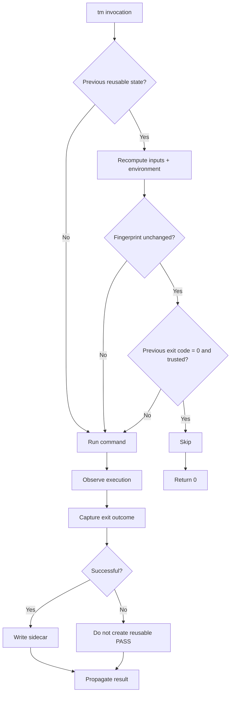

The design deliberately avoids requiring developers to maintain dependency declarations.

The test command itself reveals its dependencies through execution.

The resulting model is:

> **A successful command result remains valid until something that contributed to that result changes.**

That principle can apply consistently across Python, Kotlin/JVM, Go, Rust, shell scripts, compiled tests, linters, schema validators, security scanners, and other deterministic CI verification tasks.
