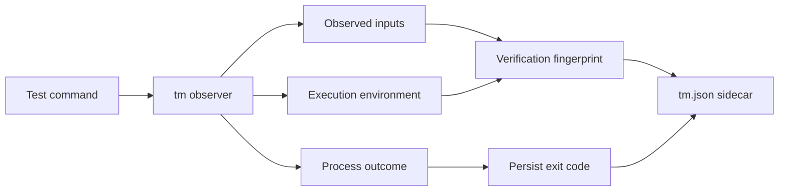
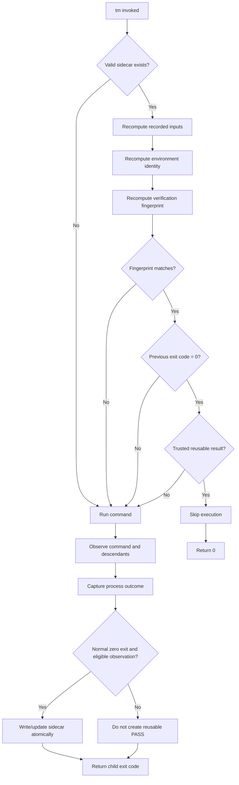
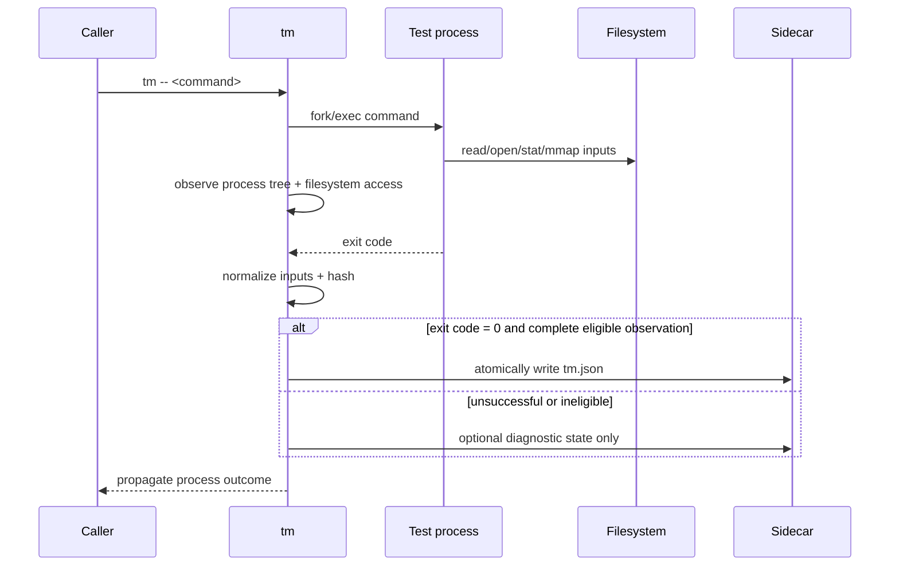
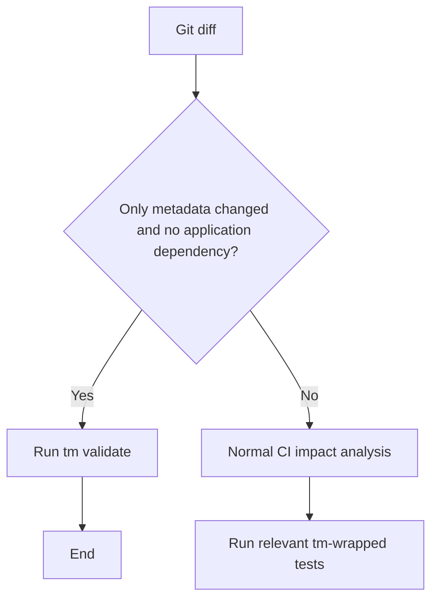
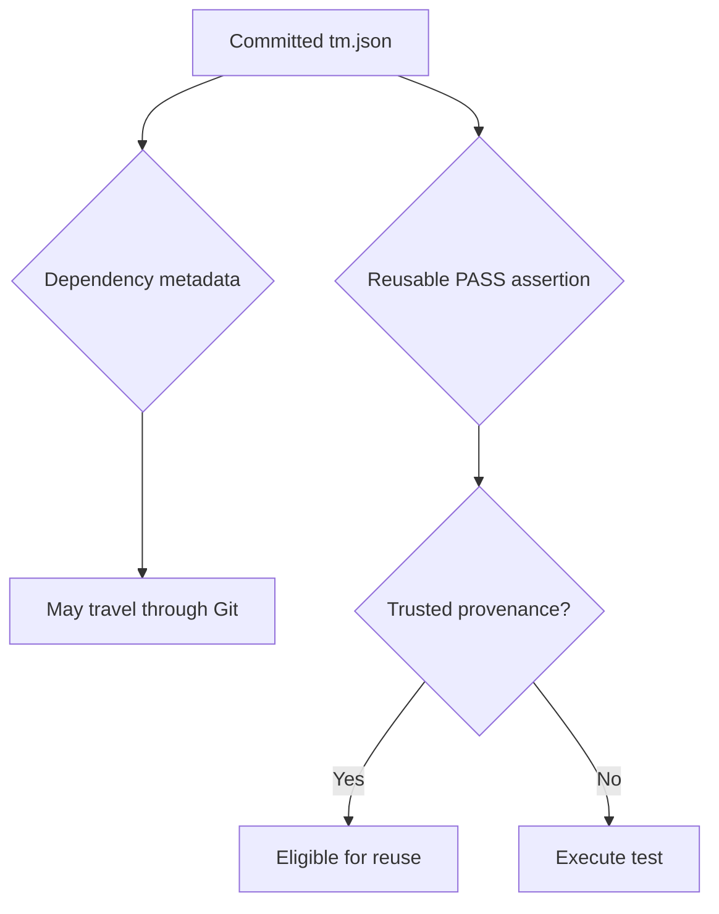
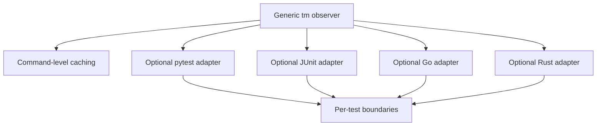
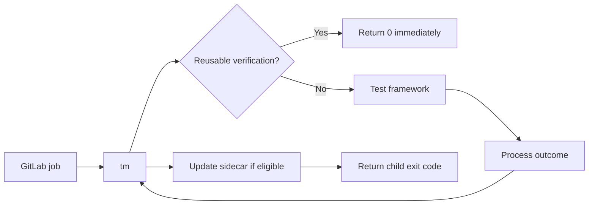
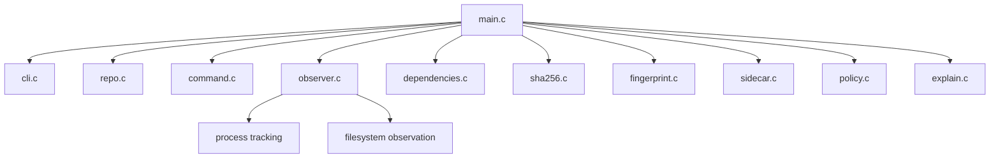
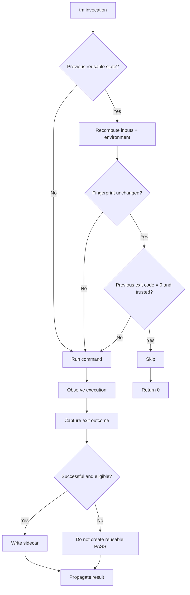

# tm — Test Memoization Utility

## Technical Specification

**Status:** Revised design; cache implementation pending
**Target implementation:** C, Linux-first  
**Primary purpose:** Language-agnostic memoization of successful test and verification commands  
**Invocation model:**

```bash
tm -- <test command>
```

Examples:

```bash
tm -- pytest tests/test_risk.py
tm -- go test ./pkg/risk
tm -- cargo test risk_score
tm -- ./gradlew test
tm -- ./tests/test_import.sh
tm -- ./build/unit_tests
```

---

# 1. Purpose

`tm` is a small, language-agnostic command-line utility that reduces unnecessary repeated test execution.

It runs an arbitrary test command, observes the files and execution context used by that command, records the resulting dependency fingerprint and process exit code, and reuses a previous successful result when the effective inputs have not changed.

The fundamental invariant is:

> If the command, its relevant inputs, and its execution environment are unchanged from a previous successful execution, rerunning the same deterministic test provides no additional information.

`tm` treats a successful execution as reusable only within an explicitly enabled verification profile. Success alone does not establish determinism or complete observation. Arbitrary commands can always run; only the supported subset can skip.

The current implementation is a process wrapper only. Sections below specify target behavior, not implemented features. Version 0.1 reuse requires a trusted operator to declare that the command is deterministic, has no required output artifacts or side effects, and runs with stable inputs and a controlled runtime. Without this profile, `tm` executes without authorizing reuse. The profile is supplied by local/CI operator configuration outside the checkout; no executable repository configuration is trusted. Its versioned, canonical policy digest contributes to every fingerprint. The configuration interface must be delivered before enabling skips.



---

# 2. Goals

`tm` MUST:

1. Execute arbitrary test commands.
2. Determine success or failure from the actual child process outcome.
3. Observe runtime filesystem dependencies of the command and its descendants.
4. Persist dependency metadata in a command-keyed `tm.json` sidecar (section 7).
5. Hash relevant repository-controlled inputs using SHA-256.
6. Skip tests whose complete verification fingerprint matches a previously successful execution.
7. Return the same successful exit code to the caller when a test is skipped.
8. Preserve the original exit status when a test actually runs.
9. Work consistently across developer machines and CI/CD pipelines.
10. Allow sidecars to be committed to Git.
11. Ensure changes to `tm` metadata do not themselves invalidate application tests.
12. Provide metadata validation so CI can avoid broad testing for sidecar-only changes under section 23.
13. Default to rerunning whenever `tm` cannot establish that reuse is safe.
14. Be implemented as a small native utility, initially targeting Linux.
15. Require no changes to the test code itself.

---

# 3. Non-goals

The initial implementation MUST NOT attempt to:

- replace pytest, JUnit, Go Test, Cargo Test, Gradle, or other test frameworks;
- become a general-purpose build system;
- build a complete static dependency graph of the repository;
- understand source-code semantics;
- automatically determine database row-level dependencies;
- treat arbitrary external network state as cacheable;
- infer whether nondeterministic tests are logically safe to cache;
- replace CI orchestration;
- persist reusable failed results;
- determine individual test-case results inside a multi-test command unless an optional adapter provides those boundaries.

---

# 4. Core Model

A reusable verification result is defined by:

```text
verification =
    command
  + test identity
  + repository input state
  + declared environment state
  + execution semantics
```

The result of an actual execution is:

```text
verification fingerprint -> process outcome
```

Only a normal successful process exit is reusable.

For version 1:

```text
exit_code == 0
```

means that the execution is eligible for reuse.

A previous non-zero exit code MUST NOT cause the next invocation to be skipped.

---

# 5. High-Level Execution Flow



---

# 6. Repository Root

`tm` MUST determine the root using explicit `--root`, otherwise the closest ancestor with a `.git` file or directory, otherwise the working directory. `--root` is a target 0.1 option, not yet implemented.

The working directory MUST be within the root for reuse. Persist repository paths relative to the root, using `/`, with `.` only for the root itself. Reject absolute paths, NUL, empty components, `..`, and ambiguous encodings. Version 0.1 supports UTF-8 paths; unsupported names cause RUN without reusable state.

Lexical normalization MUST NOT erase symlink dependencies. Resolve accesses using each process's actual cwd, root, and directory descriptors. Record the symlink chain and classify the resolved destination; a link under the repository does not make an external target a repository input. Root relocation must not by itself change relative input names. Absolute user-specific paths MUST NOT be persisted.

---

# 7. Sidecar Location

Version 0.1 MUST use one location for all commands:

```text
.tm/commands/<command-id>.tm.json
```

`command-id` is the command fingerprint defined in section 17, without the `hmac-sha256:` prefix. This avoids guessing a primary test from arbitrary arguments and prevents commands with different flags or working directories from overwriting one another. Adjacent per-test sidecars are deferred to adapters.

A command-keyed sidecar is local-key-specific; clones may retain it as readable dependency metadata but do not locate an authorized hit using their new key. Cross-machine sidecar deduplication is deferred.

The sidecar location MUST NOT contribute to the verification fingerprint. State paths MUST be opened without following symlinks outside the metadata directory. A hostile or unwritable metadata path causes uncached execution.

---

# 8. Sidecar Format

The sidecar MUST use a closed, versioned JSON schema. The following is schematic; angle-bracket digest placeholders are not valid persisted values:

```json
{
  "schema_version": 1,
  "tm_semantics_version": 1,
  "identity": {
    "command_fingerprint": "hmac-sha256:<64 lowercase hex digits>",
    "working_directory": "."
  },
  "inputs": [
    {
      "path": "tests/test_risk.py",
      "kind": "file",
      "sha256": "sha256:<64 lowercase hex digits>"
    }
  ],
  "environment": {
    "profile_digest": "sha256:<64 lowercase hex digits>",
    "runtime_digest": "sha256:<64 lowercase hex digits>",
    "context_hmac": "hmac-sha256:<64 lowercase hex digits>"
  },
  "verification_fingerprint": "sha256:<64 lowercase hex digits>",
  "result": { "exit_code": 0, "signal": null }
}
```

Raw argv and environment values MUST NOT be stored: they may contain credentials or user-specific paths. The command fingerprint uses the private keyed construction in section 17. Reusable sidecars contain only normal zero outcomes; other outcomes belong in local diagnostics.

Canonical encoding MUST use RFC 8785 JSON Canonicalization Scheme (JCS), UTF-8, no BOM, followed by one LF for the stored file. Hash the JCS bytes without that LF. Schema integers are bounded nonnegative integers no greater than `2^53 - 1`; floating point values are forbidden. Reject duplicate keys, unknown fields, unsupported versions, invalid Unicode, duplicate input records, invalid digest syntax, and invalid paths. Arrays of dependencies are sorted by UTF-8 bytes of `(path, kind)`; argv order remains significant. Never normalize Unicode in paths or argv. See [RFC 8785](https://www.rfc-editor.org/rfc/rfc8785).

Input variants have exact fields: `file` has `path`, `kind`, `sha256`; `exists` has `path`, `kind`, `state` (boolean); `directory` has `path`, `kind`, `sha256` of its canonical membership; `symlink` has `path`, `kind`, `target` (relative target text without user-specific paths). Unsupported variants cause RUN. Metadata-sensitive operations not expressible by these variants make the run non-reusable (section 13).

Timestamps, hostname, username, PID, temporary paths, duration, pipeline ID, branch name, secret values, and raw secret digests MUST NOT appear in sidecars. Sensitive paths also make an invocation ineligible for a committed sidecar; validation cannot automatically identify every secret. Diagnostics MUST follow the same secret-redaction policy and MUST NOT affect fingerprints.

---

# 9. Process Outcome

The authoritative result MUST be the actual child-process outcome.

Normal completion:

```json
{
  "exit_code": 0,
  "signal": null
}
```

Failure:

```json
{
  "exit_code": 1,
  "signal": null
}
```

Signal termination:

```json
{
  "exit_code": null,
  "signal": 11
}
```

`tm` MUST NOT persist a second authoritative status such as:

```text
PASS
FAIL
SUCCESS
ERROR
```

These states MAY be derived for display.

Interpretation:

```text
exit_code == 0       successful
exit_code != 0       unsuccessful
terminated by signal unsuccessful
```

---

# 10. Exit-Code Transparency

When a test actually executes, `tm` MUST preserve normal numeric exit codes. For signal termination it MUST return `128 + signal`; it does not promise to terminate itself with the same signal.

```text
pytest exits 0
-> tm records exit_code=0
-> tm exits 0
```

```text
pytest exits 2
-> tm records exit_code=2
-> tm exits 2
```

When a successful result is reused:

```text
matching trusted fingerprint
+ previous exit_code = 0

-> test is not executed
-> tm exits 0
```

Existing CI systems can consume these numeric outcomes; enabling trusted reuse additionally requires section 26 configuration.

---

# 11. Input Discovery

`tm` MUST discover inputs dynamically by observing execution of the command and its descendants.

The test itself does not need to declare its dependencies.

The first execution acts as discovery.



---

# 12. Process-Tree Tracking

The observer MUST attach before the first child exec and follow every thread and descendant across fork, vfork, clone/clone3, execve/execveat, and posix_spawn's underlying operations. It MUST track descriptor duplication, inheritance, close, cwd changes, and thread-shared descriptor/cwd state.

Completion of the direct child is insufficient for publication. All traced descendants must be accounted for and finished; a daemon that outlives the direct child makes the run non-reusable. Version 0.1 then detaches safely and returns the direct child's outcome without waiting indefinitely. Descendant failures handled by the parent do not independently redefine the command's outcome.

Trace loss, unsupported ABI transitions, failed attachment, privilege transitions, escaped processes, or unresolved process state make the entire invocation non-reusable. Preserve child signal delivery, and handle interruption of the wrapper without publishing success. Existing signal return-code conversion does not imply full signal forwarding is implemented.

---

# 13. Filesystem Dependency Types

All supported input kinds are mandatory for reusable runs:

- **File contents:** hash the bytes of regular files read, executable/interpreter files, and file-backed mappings. Opening a file for potential reading may conservatively count as a content dependency.
- **Existence:** record positive and negative probes, including unsuccessful executable search candidates. Only absence explained by `ENOENT`/`ENOTDIR` can be modeled as a negative existence dependency; permission and other errors require an equivalent modeled condition or no reuse. Record path-resolution dependencies as well.
- **Directory membership:** hash a JCS array of `[name, type]` pairs sorted by UTF-8 name bytes (`type` is `file`, `directory`, or `symlink`; unknown/special types disable reuse), excluding `.` and `..`. A partial enumeration conservatively depends on the entire directory. See section 22 for metadata visibility.
- **Symlinks:** track each traversed link, its target text, and the final target dependency. Cycles, unresolved targets, external escapes, or nonportable target text prevent reuse unless covered by the controlled runtime.

`stat`, `access`, and related calls expose more than existence. If a command can observe unmodeled size, timestamps, mode, ownership, inode, permissions, xattrs, or directory ordering, the MVP MUST mark it non-reusable. A later version may add exact metadata projections with a semantics-version change. Merely hashing file contents does not validate those observations.

Tracked and untracked files are equally relevant. Git tracking status and `.gitignore` MUST NOT exclude observed inputs. `.git` itself is an ordinary dependency if the child reads it; unsupported or volatile Git state causes RUN.

---

# 14. Required Linux Observation Baseline

Use `ptrace` for the first backend on Linux x86-64 native ABI. Attach before exec; enable syscall entry/exit observation and fork, vfork, clone, exec, and exit event tracking. Other architectures/ABIs execute uncached until separately supported. `LD_PRELOAD` alone is insufficient because commands may bypass it. The Linux [ptrace manual](https://man7.org/linux/man-pages/man2/ptrace.2.html) defines the required process event mechanisms.

The backend MUST maintain an explicit syscall classification table for the supported ABI. Each syscall must be modeled, proven irrelevant to reuse, or mark the invocation non-reusable. Unknown calls MUST NOT silently pass as safe.

Coverage includes:

- open/openat/openat2, reads and vectored/positioned reads, executable loading, mmap and file-backed mappings;
- stat/fstat/newfstatat/statx, access/faccessat/faccessat2, readlink/readlinkat, getdents/getdents64;
- chdir/fchdir, dup variants, fcntl descriptor operations, close/close_range, descriptor inheritance;
- writes, truncation, rename, unlink, links, directory creation, permission changes, and writable mappings for mutation detection;
- socket creation/use and all process creation/exec paths.

`io_uring`, unmodeled ioctls, mount/root/namespace changes, external shared memory/IPC, descriptor passing, device access, and any other unmodeled input channel make the execution non-reusable. Inherited descriptors other than controlled stdin/stdout/stderr are unsupported in 0.1. Input from a terminal, pipe, or uncontrolled stdin forces RUN; use `/dev/null` for eligible commands. Stdout/stderr writes are permitted but never replayed on a skip.

Observer setup failure MUST run the command once without caching. Failure after launch MUST preserve the running invocation where possible and revoke eligibility; it MUST NOT restart a command that may already have performed effects.

---

# 15. Input Classification and Runtime Identity

Repository inputs are fingerprinted individually. External mutable inputs are non-cacheable in version 0.1. Exceptions are files in a controlled, read-only runtime whose full content is identified by an immutable digest in the trusted execution profile.

Interpreter/compiler version strings and a container image tag are insufficient. An OCI image digest can identify image content, but not writable layers, bind mounts, host configuration, kernel state, or external services. A runtime provider must ensure the digest covers the executable, interpreter, shared libraries, loader configuration, packages, and system data actually used. Host caches, home directories, `/proc`, `/sys`, and mutable mounts are unsupported unless their input semantics are explicitly covered. `/dev/null` is the only initial device exception.

The profile MUST define runtime digest, observer ABI and semantics, stable workspace policy, permitted input roots, filesystem/metadata capabilities, deterministic-command declaration, and no-required-effects declaration. It MUST be operator controlled; repository changes cannot weaken it. Missing or unverifiable coverage means RUN. Version 0.1 may provide fewer cache hits on ordinary developer hosts than in controlled CI; correctness takes priority over coverage.

---

# 16. Test Source and Executables

The executed binary, script/interpreter chain, and loaded test sources MUST contribute through observed inputs or the controlled runtime. `tm` cannot infer a primary test file from an arbitrary argv.

Use target option `--input <relative-file>` for an additional known input not read directly (for example, source corresponding to a generated binary). Explicit input files MUST be hashed before launch and validated under section 38; missing or unsupported inputs disable publication, but the command still runs. Transitive input discovery remains the observer's responsibility.

---

# 17. Command Identity

The following commands MUST be considered different:

```bash
pytest tests/test_foo.py
pytest -x tests/test_foo.py
```

Likewise:

```bash
cargo test foo
cargo test foo --release
```

`tm` MUST canonicalize and fingerprint:

- executable;
- arguments;
- working directory;
- execution-relevant options.

Commands MUST be represented as exact argument vectors rather than flattened strings and launched without an implicit shell. Preserve empty arguments and argument boundaries.

In all digest formulas, `\0` denotes one NUL byte, `||` byte concatenation, and hex output uses lowercase.

Define `command_fingerprint = "hmac-sha256:" + hex(HMAC-SHA256(K, "tm-command-v1\0" || JCS({argv, working_directory, execution_options})))`, where `K` is the local trust-domain key from section 26. This keyed digest prevents offline guessing of secret arguments. Unsupported non-UTF-8 argv disables reuse. `--force` and `--explain` are wrapper controls and do not alter command identity. Input declarations are execution options; root location itself is not.

Executable resolution MUST be revalidated, including PATH search misses, the selected executable, interpreters, and runtime coverage. Identical argv with a different executable MUST not hit. Recompute this identity from the current invocation; never accept identity solely from sidecar JSON.

---

# 18. Verification Fingerprint

The verification fingerprint MUST be computed from a deterministic canonical representation containing at least:

```text
tm semantics version
command identity
working directory
test source
observed repository inputs
declared additional inputs
environment identity
```

Conceptually:

```text
verification_fingerprint =
    SHA256(
        canonical(
            tm_semantics_version,
            command,
            working_directory,
            sorted_inputs,
            environment_identity
        )
    )
```

Precisely, hash `"tm-verification-v1\0" || JCS({schema_version, tm_semantics_version, identity, inputs, environment})` with SHA-256. The result, fingerprint field itself, provenance receipt, and sidecar path are excluded from this preimage. The trusted receipt binds the complete canonical sidecar, including the zero result. Semantic changes to observation, canonicalization, or policy interpretation MUST invalidate old receipts.

Individual input hashes MUST remain available in the sidecar for diagnostics even if the aggregate fingerprint is sufficient for the skip decision.

---

# 19. Skip Decision

`tm` MAY skip execution only when all of the following are true:

1. a valid sidecar exists;
2. its schema version is understood;
3. its test/command identity matches;
4. its previous execution exited normally;
5. its previous exit code was `0`;
6. every recorded input remains equivalent;
7. the execution environment identity remains equivalent;
8. no policy condition requires forced execution;
9. the sidecar matches a current private success receipt under section 26;
10. the current trusted profile still establishes eligibility, input stability, and runtime coverage;
11. current inputs are read from one stable state, not a mixture of concurrent revisions.

Otherwise:

```text
RUN
```

MUST be the default.

---

# 20. Failed and Ineligible Executions

Failed results MUST NOT authorize skips. Before any actual run, including `--force`, `tm` MUST durably revoke the existing success receipt for that command under the per-command lock. This ensures a failed forced run cannot leave an older successful result eligible for reuse.

A nonzero exit, signal, observer failure, incomplete process tree, changed input during execution, or successful but ineligible run leaves no reusable receipt. A prior committed sidecar may remain as discovery metadata; without a receipt it cannot skip. Record failure reasons only in private diagnostics. If revocation cannot be made durable, disable reuse for the affected trust store until repaired; report the storage fault.

---

# 21. Relearning Dependencies

Whenever a test actually executes, `tm` MUST rebuild its observed dependency set.

Example:

Previous execution:

```text
test
-> foo.py
-> bar.py
```

New `foo.py` introduces:

```text
new_module.py
```

Because `foo.py` changed, the previous verification is invalidated. The test runs and `tm` relearns:

```text
test
-> foo.py
-> bar.py
-> new_module.py
```

This allows the dependency set to evolve naturally.

---

# 22. Metadata Exclusion

Supervisor reads and writes of its metadata MUST NOT enter the child dependency set. Only reserved `.tm` directories are metadata; do not broadly ignore every file ending in `.tm.json`.

Child access is different: a child that reads, probes, or enumerates `.tm` can change behavior when metadata changes. Such a command MUST become non-reusable in observer-only mode. Directory membership observations containing a `.tm` entry also make the run non-reusable, unless an enforced execution view hides metadata consistently during discovery and validation. Simply deleting entries from an observed hash is unsound.

Writing a sidecar therefore does not invalidate an otherwise eligible test. Commands that actually depend on metadata receive RUN, not a false skip. Hiding metadata with a sandbox is a future optimization.

---

# 23. Git and CI Behavior

Sidecars are intended to be committed to Git.

This allows successful dependency knowledge to travel between:

- developers;
- branches;
- CI pipelines;
- clean environments.

CI SHOULD avoid broad test execution for changes consisting exclusively of reserved `tm` metadata, provided the application does not consume it. This is repository CI policy; the wrapper cannot enforce pipeline triggering. If tests consume metadata, section 22 applies and CI must retain the relevant tests.

Repository CI SHOULD classify:

```text
**/.tm/**
```

as verification metadata.

A sidecar-only change SHOULD produce:

```text
tm validate
```

rather than normal application testing.



---

# 24. `tm validate`

Target version 0.1 provides `tm validate [--root <directory>]`. It scans `.tm/commands/*.tm.json` without executing tests or following symlinked state paths. It checks the closed schema, canonical byte encoding, supported semantics, digest syntax, safe paths, input ordering/uniqueness, and normal zero result. It recomputes the embedded verification fingerprint from the stored payload, without claiming current inputs still match.

Exit codes are `0` for structurally valid files (including an empty set), `1` for invalid sidecars, and `125` for command usage or validation I/O failure. Report trust separately as trusted/untrusted/unknown when the local store is available. Structural validity does not prove provenance, current freshness, or freedom from secrets; validation MUST NOT mint a success receipt. No represented test runs, even if metadata is invalid.

---

# 25. Trust and Provenance

Committed verification state creates a security issue.

A contributor MUST NOT be able to forge a sidecar that causes CI to skip an unverified change.

Dependency metadata and verification trust MUST therefore be considered separately.



The assertion:

```text
fingerprint ABC was successfully verified
```

MUST have authenticated provenance before reuse.

---

# 26. Initial Provenance Model

Version 0.1 supports local trust only. A trusted `tm` supervisor records an authenticated success receipt in a private state store outside the checkout, scoped to the repository instance, trust domain, command identity, semantics, and profile. The receipt is `HMAC-SHA256(K, "tm-receipt-v1\0" || canonical_sidecar_bytes)` (JCS bytes without the stored trailing LF); it covers the full input manifest and result, not just a fingerprint supplied by JSON. The store also holds the random 256-bit key `K`, generated once per repository instance from the OS random source, and receipt revocation state. A new checkout receives a fresh key even if its Git remote matches. Private store keys must not be reused across instances. Use owner-only directory/file permissions (0700/0600), reject symlinks and unexpected ownership, and never commit or print the key. Key rotation or store loss invalidates reuse.

A local developer's account is the trust boundary. This protects against edited or cloned repository JSON, not malicious code with the same account's access to the store. For untrusted test code, the supervisor and its store MUST be isolated from the child by the runner (separate credentials or equivalent enforced isolation). A path outside the checkout and mode 0600 alone do not establish that isolation.

| Source | Version 0.1 behavior |
| --- | --- |
| Successful eligible local run | Supervisor publishes a receipt; later matching invocations in that repository instance may skip. |
| Fresh clone or copied sidecar | No local receipt: RUN and relearn. |
| Edited sidecar, even on protected main | Receipt mismatch: RUN. Branch ancestry grants no trust. |
| Fresh CI job | RUN unless it has a protected private store from the same configured trust domain. |
| Untrusted merge-request job | RUN unless the CI operator provides verified supervisor/store isolation; no promotion of its receipts to trusted jobs. |

MVP cross-machine receipt import and arbitrary CI cache restoration are unsupported. Shared success reuse needs a later authenticated artifact/signature protocol, issuer policy, repository scoping, and revocation rules. Portable dependency metadata remains useful without portable authorization to skip.

---

# 27. Optional Signed Attestations

A future version MAY sign the complete canonical sidecar together with repository/trust-domain identity, issuer, and policy version. Authenticating only a caller-supplied fingerprint is insufficient; the verifier must reconstruct it from the authenticated input manifest.

using a CI-controlled key.

Example:

```json
{
  "attestation": {
    "verification_fingerprint": "sha256:...",
    "exit_code": 0,
    "issuer": "trusted-ci",
    "signature": "..."
  }
}
```

This is not required for the MVP.

---

# 28. External Network State

Version 0.1 MUST mark a run non-reusable on any socket creation or attempted socket communication, even when the call fails. This deliberately conservative rule covers DNS, TCP/UDP, IPv4/IPv6, loopback, Unix-domain sockets, netlink, listeners, and local services. Inherited sockets or passed descriptors also prevent reuse. Socket-backed IPC inside the process tree is not exempt in the MVP.

Detect socket/socketpair, connect, bind, listen, accept variants, send/receive variants, and socket I/O through read/write or other transfer operations. Reading an external service cannot be made safe by observing only its endpoint. No `--external-input` value overrides this rule in version 0.1.

---

# 29. Declared Additional Inputs

Version 0.1 supports repeatable `--input <relative-file>` for regular repository files. Declarations join observed dependencies, are canonicalized, deduplicated, and contribute to identity and verification. They cannot remove observed dependencies or bypass eligibility rules.

Logical `--external-input name=digest` is deferred. A future provider must demonstrate that all service state consumed by the run is bound to that digest before network reuse can be enabled. A caller-supplied database fixture hash alone does not prove the live database matches it.

---

# 30. Environment and Execution Context

Version 0.1 fingerprints the entire environment actually delivered to the child; a variable allowlist is insufficient because environment reads need not cross the kernel boundary. Encode the environment as a JCS array of `[name, value]` pairs sorted by UTF-8 name bytes. Duplicate names or non-UTF-8 data disable reuse. An absent variable is omitted; an empty value is present, so unset and empty are distinct. Do not strip variables that the child still receives. Remove wrapper-only `TM_FORCE` before child launch, consistently for all runs.

The private `context_hmac` is HMAC-SHA256 over `"tm-context-v1\0"` plus JCS of the environment and execution context. Include kernel release, OS/architecture/ABI, CPU feature identity, effective credentials and groups, umask, resource limits, stdin policy, and stdout/stderr descriptor kinds/TTY state. Unsupported or uncontrolled context disables reuse. Values remain in memory only; persist only the keyed digest. A plain hash of a low-entropy secret is vulnerable to guessing and MUST NOT be persisted.

The public environment object contains only the profile digest, immutable runtime digest, and context HMAC. Local keys intentionally prevent automatic cross-machine fingerprint matching. Host-specific environment values may reduce cache hits; do not normalize them unless the same normalization is applied to the actual child environment by the trusted runner.

`--env-input` is deferred because all delivered variables are already included. Any later filtering must specify both the execution environment and fingerprint semantics.

---

# 31. Time, Randomness, and Determinism

Detected clock, entropy, uncontrolled device, or other nondeterministic input makes the MVP run non-reusable. This includes time syscalls, getrandom, and reads of random devices.

Syscall tracing cannot prove the absence of nondeterminism: time can be read through the vDSO, and programs can use CPU instructions or scheduling-dependent behavior. See the Linux [vDSO manual](https://man7.org/linux/man-pages/man7/vdso.7.html). A successful trace MUST NOT be described as proof of determinism.

Reuse additionally requires the trusted profile's explicit assertion that the command's result is deterministic under its controlled inputs/context. Flaky tests and tests whose pass/fail depends on uncontrolled time, randomness, concurrency, or resource availability are ineligible. Without that assertion, run normally. Stronger mechanical guarantees require a future enforced execution environment.

---

# 32. Generic Command Granularity

Without framework-specific integration:

```bash
tm -- pytest tests/
```

represents one verification command.

Its sidecar means:

> The entire command completed successfully with these observed inputs.

Likewise:

```bash
tm -- go test ./...
```

is one cache unit.

This is sufficient for the generic implementation.

---

# 33. Optional Framework Adapters

Future adapters MAY improve granularity.

Examples:

- pytest;
- JUnit;
- Go test;
- Cargo test.

Adapters could notify `tm` of individual test boundaries:

```text
TEST_START identifier
TEST_END identifier result
```

The low-level dependency observer remains generic.

Adapters SHOULD only supply:

- test identity;
- start boundary;
- end boundary;
- optional framework result metadata.

They SHOULD NOT implement a separate dependency-discovery mechanism.



---

# 34. CLI

Implemented today:

```text
tm [--force] [--explain] -- COMMAND [ARGUMENT ...]
tm --help
```

Before the mandatory `--`, recognize `--force`, `--explain`, and `--help`/`-h`. Repeated flags are idempotent. Help returns 0 immediately when encountered during parsing. Unknown options, a missing separator, or an empty command return 125. Everything after `--` belongs verbatim to the child. No shell expansion is performed by `tm`.

Target 0.1 additions (not yet implemented):

```text
tm [--root DIR] [--input FILE ...] [--force] [--explain] -- COMMAND [ARGUMENT ...]
tm validate [--root DIR]
tm clean [--root DIR]
```

Missing option values or unknown subcommand options return 125. Repeatable `--input` adds files; repeated `--root` is a usage error. Trusted execution-profile and private-store configuration must be specified and implemented before the skip milestone. Omission of that configuration always means RUN.

---

# 35. `tm --force`

Example:

```bash
tm --force -- pytest tests/test_foo.py
```

MUST execute the command regardless of cached state.

Before execution revoke the old receipt; after an eligible successful execution rebuild the sidecar and receipt normally. Failure leaves the receipt revoked.

Version 0.1 MUST also support the exact value `TM_FORCE=1` (not yet implemented); other values have no forcing effect:

```bash
TM_FORCE=1
```

Use cases:

- debugging;
- nightly exhaustive testing;
- cache-validation runs;
- confidence checks;
- investigating suspected false skips.

---

# 36. `tm --explain`

`tm` SHOULD explain its decision.

Example skip:

```text
SKIP tests/test_score.py

Reason:
  previous successful verification fingerprint matches

Fingerprint:
  sha256:8a84...
```

Example execution:

```text
RUN tests/test_score.py

Reason:
  src/risk/scoring.py changed

Previous:
  sha256:abc123...

Current:
  sha256:def456...
```

Other possible reasons include:

```text
no sidecar
command changed
test file changed
environment changed
external network dependency
previous execution failed
sidecar untrusted
tm semantics changed
forced execution
```

---

# 37. `tm clean`

`tm clean [--root DIR]` revokes all receipts for this repository instance and removes generated files from root `.tm/commands/` without following symlinks. It MUST not delete arbitrary `.tm` content belonging to other tools. Serialize cleanup against publication using the same repository/store locking hierarchy as runners.

Return 0 on success, 125 for usage or I/O errors; cleanup never runs tests. Deleting sidecars or private state only causes more executions. Selective cleanup and discovery of future adjacent sidecars are deferred.

---

# 38. Input Stability and Publication

A result must describe inputs actually consumed, not merely the files left on disk afterward. Post-run hashing alone can certify the wrong revision. Before/after equal hashes also do not detect a change followed by restoration.

Version 0.1 reuse therefore requires the profile to establish a stable workspace/runtime view for validation and execution: an immutable snapshot/read-only view or an operator-enforced exclusion of concurrent writers. An advisory `tm` lock alone cannot exclude editors or other tools. Without this guarantee, RUN without publication. Mutable-worktree race tolerance is deferred to a stronger backend.

The observer MUST invalidate eligibility on child writes, writable shared mappings, or filesystem mutations outside stdout/stderr. Commands that build binaries, populate caches, write test reports, or require artifacts/effects for downstream steps run uncached in the MVP. Prepare those artifacts before invoking the verification unit. Skipping returns 0 and a wrapper message; it does not reproduce stdout, reports, generated files, or external effects.

Publication occurs only after a normal zero outcome, complete eligible observation, and stable input validation. Under the command lock: write a canonical sidecar to a same-directory temporary file, flush it, rename atomically, and fsync the directory; then publish the private receipt atomically and durably. Clear stale receipt state before launching as section 20 requires. A crash between sidecar and receipt publication leaves an untrusted sidecar, hence RUN. Do not follow symlinked destination paths.

Cache write failures after the command completes MUST preserve its exit code and leave no reusable receipt. Emit a redacted diagnostic. Durability failure is a cache miss, never permission to trust partial state.

---

# 39. Concurrency

Use an exclusive per-command lock in the private store across validation, receipt revocation, execution, and publication. A waiting runner revalidates after acquiring the lock; it may reuse a newly published eligible result unless forced. The lock key is the repository instance plus command identity. Lock ordering for repository cleanup and command operations MUST be consistent.

If locking fails, run uncached without publishing. This serializes receipt lifecycle and prevents an older concurrent success from overwriting a later failed attempt for the same command. Different commands may run concurrently only if the stable input guarantees still hold. Distributed locking is out of scope.

---

# 40. SHA-256

SHA-256 MUST be the standard content hash for version 1.

Format:

```text
sha256:<hex>
```

Hash algorithms MAY become versioned later.

---

# 41. Performance

`tm` only provides value if:

```text
cost of checking inputs << cost of rerunning tests
```

Potential future optimizations include:

- cache file hashes using inode/mtime/size;
- parallel hashing;
- repository-level content index;
- reuse Git object hashes where safe;
- aggregate directory fingerprints;
- memory-mapped metadata database.

These optimizations MUST NOT weaken correctness.

The initial implementation MAY hash all recorded repository inputs directly.

---

# 42. Git Optimization

Tracked repository files already participate in Git object identity.

A future implementation MAY use Git information to accelerate change detection.

However, the canonical `tm` verification state SHOULD remain explicitly defined rather than implicitly depending on Git implementation details.

Git SHOULD be treated as an optimization source, not the trust model.

---

# 43. Sidecar Changes and Test Impact Analysis

Repository-wide impact analyzers SHOULD classify reserved metadata paths as follows, subject to the child-access exception in section 22:

```text
**/.tm/**
```

as non-application metadata.

Changing a generated sidecar (future adjacent layout shown):

```text
tests/risk/.tm/test_score.py.tm.json
```

MUST NOT imply:

```text
risk code changed
```

nor:

```text
rerun every test
```

The normal reaction is:

```text
validate sidecar
```

This rule applies to:

- GitLab `rules:changes`;
- Pants target inference;
- custom impact analyzers;
- repository automation;
- agent workflows.

---

# 44. Self-Invalidation Prevention

`tm` MUST ensure that writing or reading its own metadata does not modify the verification fingerprint.

The observer MUST distinguish:

```text
tm supervisor activity
```

from:

```text
child process activity
```

---

# 45. Sandbox Integration

The initial observer may run without a sandbox, but reuse then relies on the explicit trusted-profile preconditions in sections 15, 26, 31, and 38. Observation alone does not enforce them.

A later version SHOULD support optional sandboxing:

```bash
tm --sandbox -- pytest ...
```

Possible mechanisms include:

- mount namespaces;
- user namespaces;
- temporary filesystem overlays;
- restricted network namespaces.

Sandboxing can improve correctness by exposing hidden dependencies.

---

# 46. CI Integration

Example GitLab job:

```yaml
unit-tests:
  script:
    - tm -- pytest tests/unit/
```

If nothing relevant changed:

```text
tm loads trusted sidecar
-> validates fingerprint
-> skips pytest
-> exits 0
```

If an input changed:

```text
tm invalidates result
-> executes pytest
-> records dependencies
-> exits with pytest exit code
```



Exit-code consumption needs no special CI protocol. Enabling reuse requires the operator-controlled profile and private trust store from section 26; a committed sidecar alone always runs on a fresh worker.

---

# 47. Exhaustive Validation CI

Repositories adopting `tm` SHOULD continue running periodic exhaustive tests.

Example:

```yaml
nightly-full-tests:
  variables:
    TM_FORCE: "1"
  script:
    - tm -- pytest tests/
```

This provides a backstop against:

- missing dependencies;
- observer bugs;
- unexpected nondeterminism;
- previously unknown environmental inputs.

False skips discovered during exhaustive runs SHOULD drive improvements to `tm` dependency semantics.

---

# 48. Recommended Validation Modes

Caching below is conditional on the profile and trust/isolation requirements. Untrusted jobs without isolation and fresh workers without receipts run their tests.

## Normal MR

```text
tm caching enabled
```

Goal: fast developer feedback.

## Main branch

```text
tm caching enabled
```

Goal: verify affected state efficiently.

## Nightly

```text
TM_FORCE=1
```

Goal: exhaustive regression.

## Release qualification

Policy-dependent:

```text
TM_FORCE=1
```

or stricter verification profile.

---

# 49. Safety Principle

The central safety rule is:

> When uncertain, execute.

Conditions that MUST force execution:

```text
unknown sidecar version
malformed metadata
missing recorded input
ambiguous environment
untrusted verification state
uncontrolled network dependency
unsupported filesystem operation affecting input discovery
hashing failure
observer failure
```

Invalid or missing prior metadata may be replaced after a new eligible execution. An unresolved observation, context, or stability failure during that execution prevents publication.

`tm` is an optimization layer. It MUST fail toward more testing rather than less testing.

---

# 50. Logging

Normal operation SHOULD be terse.

Example:

```text
tm: SKIP tests/test_score.py [cached successful verification]
```

or:

```text
tm: RUN tests/test_score.py [src/risk.py changed]
```

Verbose mode MAY expose dependency details.

Secrets MUST never be printed or persisted.

---

# 51. Return-Code Handling

`tm` itself may encounter errors before the child command runs.

The application MUST use the documented wrapper error codes below.

Required conventions:

```text
125 = tm usage or internal error
126 = command found but cannot execute
127 = command not found
```

A child-process exit code MUST otherwise pass through unchanged, including 125–127; these numeric values cannot distinguish wrapper and child errors by themselves. A signal-terminated child returns `128 + signal`. Cache/observer faults do not replace a collected child outcome. Before launch, cache faults cause uncached execution; unrecoverable fork/wait failures return 125.

---

# 52. MVP Scope and Delivery Gates

Version 0.1 targets Linux x86-64 and C11. The wrapper can run arbitrary commands; reuse is limited to deterministic verification commands with controlled stdin, immutable inputs/runtime, supported filesystem observations, no network/IPC, and no required output effects.

Deliver in this order:

1. **Wrapper (implemented):** argv preservation, numeric outcomes, force/explain parsing, CLI checks.
2. **Observer, no skips:** ptrace process tracking, explicit syscall classification, input discovery, network/mutation/unsupported-operation reasons; preserve command outcomes on observer faults.
3. **Metadata, no skips:** frozen schema, canonical hashes, context HMAC, operator-profile/store configuration interface, strict validation, command-keyed storage, clean, and atomic writes.
4. **Local reuse gate:** private receipt lifecycle and isolation policy, stable workspace/runtime validation, locking, failed-run revocation, and all section 59 safety cases demonstrated.
5. **Measured pilot:** compare forced outcomes with cache decisions for representative eligible commands before expanding supported operations.

Skips MUST remain disabled through gates 1–3. Reuse approved SHA-256/HMAC and JSON implementations where feasible; cryptographic primitives should not become a bespoke subsystem.

Deferred: cross-machine trust import, signatures, remote services, framework adapters, output replay, mutable external state, automatic determinism inference, broad host-runtime support, eBPF, Windows/macOS, external-input overrides, and environment filtering. No delivery-date claim is made before the observer prototype measures eligibility and overhead.

---

# 53. Suggested Internal Architecture

```text
main.c
├── cli.c
├── repo.c
├── command.c
├── observer.c
│   ├── process tracking
│   └── filesystem events
├── dependencies.c
├── sha256.c
├── fingerprint.c
├── sidecar.c
├── policy.c
└── explain.c
```



Responsibilities MUST remain separated.

The observation backend SHOULD be abstracted enough that a `ptrace` implementation can later be replaced or complemented by eBPF, seccomp, or sandbox-based observation without changing sidecar semantics.

---

# 54. Example Lifecycle

Initial repository:

```text
src/foo.py
tests/test_foo.py
```

Developer runs:

```bash
tm -- pytest tests/test_foo.py
```

Observed:

```text
tests/test_foo.py
src/foo.py
src/common.py
```

pytest exits:

```text
0
```

`tm` writes:

```text
.tm/commands/<command-id>.tm.json
```

and exits `0`.

A second developer clones the repository and executes:

```bash
tm -- pytest tests/test_foo.py
```

In version 0.1 the clone has no matching private receipt and MUST execute. Later eligible runs in that same repository instance may skip when all inputs and trust state match. This lifecycle assumes the runner supplies an eligible profile; ordinary pytest invocations may write caches or perform unsupported observations and thus remain uncached.

If `src/foo.py` changes:

```text
foo.py hash differs
-> previous verification invalid
-> pytest executes
-> dependencies relearned
-> new sidecar written
```

---

# 55. Example Explain Output

```text
$ tm --explain -- pytest tests/test_risk.py

RUN pytest tests/test_risk.py

Previous verification:
  sha256:d4821c...

Invalidated by:
  src/risk/scoring.py

Previous:
  sha256:f68abc...

Current:
  sha256:892ef1...

Executing...
```

After success:

```text
Exit code: 0
Recorded inputs: 17
Verification:
  sha256:2c984a...
Sidecar:
  .tm/commands/<command-id>.tm.json
```

Next run:

```text
$ tm --explain -- pytest tests/test_risk.py

SKIP pytest tests/test_risk.py

Previous successful verification remains valid:
  sha256:2c984a...

Returning exit code 0.
```

---

# 56. Design Principles

## 56.1 Test-framework independence

`tm` understands processes and inputs, not pytest, Cargo, Go, JUnit, or Gradle.

## 56.2 Successful verification is reusable

A test need not be repeated when all effective inputs remain unchanged.

## 56.3 State is reconstructible

Deleting every sidecar only causes more testing. It must never compromise correctness.

## 56.4 Metadata must not cause work

Supervisor metadata activity must not create test invalidation cascades. Child dependence on metadata prevents reuse unless the execution view consistently hides it.

## 56.5 Provenance matters

A committed JSON file alone must not be sufficient to forge a trusted successful CI verification.

## 56.6 Conservative invalidation

Any uncertainty results in execution.

## 56.7 Observable simplicity

Developers must be able to understand why a test ran or was skipped without understanding `tm` internals.

---

# 57. Longer-Term Extensions

## 57.1 Per-test framework adapters

Provide finer-grained caching for:

```text
pytest test functions
JUnit test methods
Go test functions
Rust test functions
```

while retaining the generic observation engine.

## 57.2 Shared cache

Store verification results in:

```text
GitLab cache
S3
artifact registry
distributed CAS
```

in addition to repository sidecars.

## 57.3 Signed verification attestations

Allow CI-generated PASS results to be independently authenticated.

## 57.4 eBPF observer

Reduce tracing overhead and improve scalability.

## 57.5 Sandbox execution

Restrict tests to observed/declared inputs and identify hidden dependencies.

## 57.6 CI impact planner

Given:

```text
git diff A..B
```

determine which `tm` verification units are already valid without launching each wrapper individually.

## 57.7 Generic verification steps

Extend beyond tests:

```bash
tm -- ruff check src/
tm -- mypy src/
tm -- openapi-diff ...
tm -- trivy image ...
tm -- schema-validator ...
```

At that point `tm` becomes a generic memoization layer for deterministic CI verification commands.

---

# 58. Relationship to Existing Tools

`tm` overlaps conceptually with several existing tools but occupies a different layer.

## pytest-testmon

Provides Python/pytest-specific dynamic test dependency tracking.

`tm` generalizes the concept to arbitrary commands and languages.

## Pants

Provides dependency-aware target execution, caching, and build orchestration.

`tm` does not require migration to a build graph or target model.

## Bazel

Provides hermetic dependency-aware build and test caching.

`tm` aims to work with existing commands without requiring Bazel build definitions.

## Make

Caches based on declared file dependencies and timestamps.

`tm` learns runtime inputs and hashes their contents.

The intended differentiator is:

> Run an arbitrary command once, observe what it actually depended upon, and reuse its successful verification until one of those inputs changes.

---

# 59. Acceptance Criteria for Version 0.1

All reuse cases below assume an explicitly configured eligible profile, stable input view, controlled runtime, and private trust store. These are implementation acceptance criteria, not claims about the current wrapper.

## AC-01 — Basic successful caching

```bash
tm -- ./test.sh
```

First execution:

```text
test executes
exit 0
sidecar created
```

Second unchanged execution:

```text
test does not execute
tm exits 0
```

## AC-02 — Input invalidation

If a previously observed repository input changes, the test executes again.

## AC-03 — Test change invalidation

If the test script itself changes, the test executes again.

## AC-04 — Failed result

If the command exits non-zero:

```text
tm exits same non-zero value
next execution runs again
```

## AC-05 — Signal termination

If the child terminates due to a signal, the result is not reusable.

## AC-06 — Descendant dependency

If a subprocess reads a repository file, that file becomes a dependency.

## AC-07 — Sidecar isolation

Changing metadata does not change application input hashes for an eligible command. A receipt/sidecar mismatch still forces RUN. Child reads or enumeration of metadata force non-reusability in observer-only mode.

## AC-08 — Portability

Sidecars do not contain user-specific absolute paths.

## AC-09 — Force mode

```bash
tm --force -- ...
```

always executes.

## AC-10 — Explain mode

`tm --explain` identifies the reason for RUN or SKIP.

## AC-11 — Atomic sidecar writes

Interrupted sidecar writes cannot create apparently valid verification state.

## AC-12 — Uncertain state

Any observation or validation failure causes:

```text
RUN
```

rather than:

```text
SKIP
```

---

## AC-13 — Authentic provenance

A forged, edited, cloned, or structurally valid unsigned sidecar without a matching private receipt runs. Changed input manifests, results, profile, semantics, or trust key invalidate receipts. An untrusted CI job cannot write a trusted store; where isolation is unavailable, reuse is disabled.

## AC-14 — Failed forced execution and crash recovery

Success followed by forced failure, signal, or observer failure leaves no usable prior receipt. The next invocation runs even with the original inputs. Kill the supervisor before/after each publication step: incomplete state never skips.

## AC-15 — Context and privacy

Unset versus empty environment variables, changed values, argv boundaries, executable resolution, runtime digest, cwd, and supported execution-context changes invalidate reuse. Sidecars and diagnostics contain neither raw secret values/arguments nor unkeyed digests of them. Reordered environment entries serialize identically.

## AC-16 — Filesystem observations

Creating a previously missing file, adding/removing an enumerated entry, retargeting a symlink, changing an untracked dependency, and changing an executable each force RUN. Relative directory-descriptor paths and descendant reads are covered. Metadata-sensitive operations without a supported projection are ineligible.

## AC-17 — Unsupported and external inputs

DNS, failed socket attempts, loopback, Unix sockets, inherited descriptors, io_uring, unknown syscalls, trace loss, ABI transitions, and escaping descendants prevent publication. Observer failure after launch never duplicates command execution.

## AC-18 — Stable inputs and effects

Without an enforced stable input view or explicit operator guarantee, success does not publish reuse. Input writes, writable shared mappings, required reports/artifacts, uncontrolled stdin, and detected randomness prevent publication. Demonstrate that concurrent edit/change-restore scenarios cannot be certified by post-run hashing alone.

## AC-19 — Validation and concurrency

Reject malformed/duplicate/unknown fields, unsupported versions, unsafe paths, symlinked state paths, and invalid digests. `validate` never runs tests or creates receipts. Concurrent force/run/clean operations cannot resurrect revoked success. Read-only/full storage preserves the child's collected exit status and publishes no receipt.

## AC-20 — Canonical contract

Maintain golden vectors for command HMAC, environment HMAC, all input variants, verification hash, and receipt HMAC. Verify empty argv entries, Unicode, input sorting, unset/empty environment, and unknown schema handling. Raw argv and environment values never appear in committed fixtures containing real secrets.

---

# 60. Summary

`tm` is deliberately small.



Runtime observation discovers supported file dependencies; the operator must still establish the eligibility and execution-profile preconditions.

The test command itself reveals its dependencies through execution.

The resulting model is:

> **A successful command result remains valid until something that contributed to that result changes.**

That principle can apply consistently across Python, Kotlin/JVM, Go, Rust, shell scripts, compiled tests, linters, schema validators, security scanners, and other deterministic CI verification tasks.
