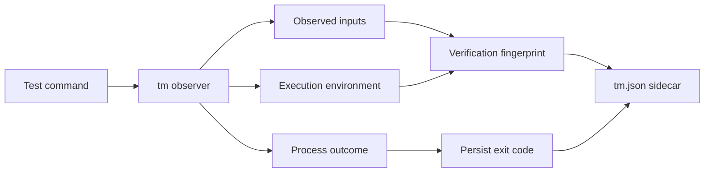
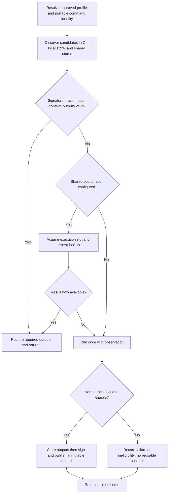
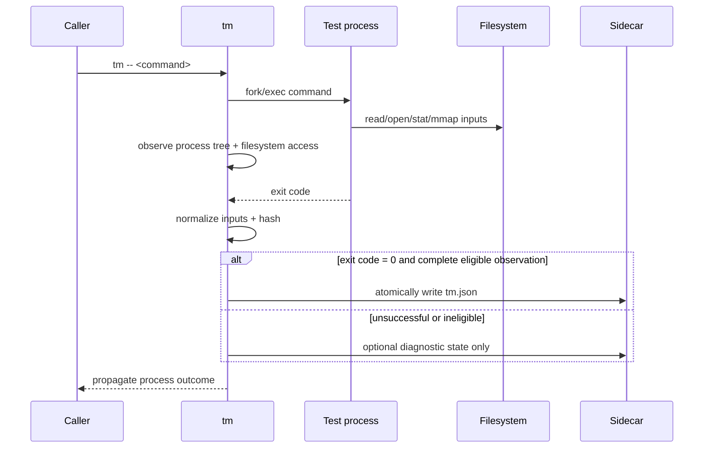
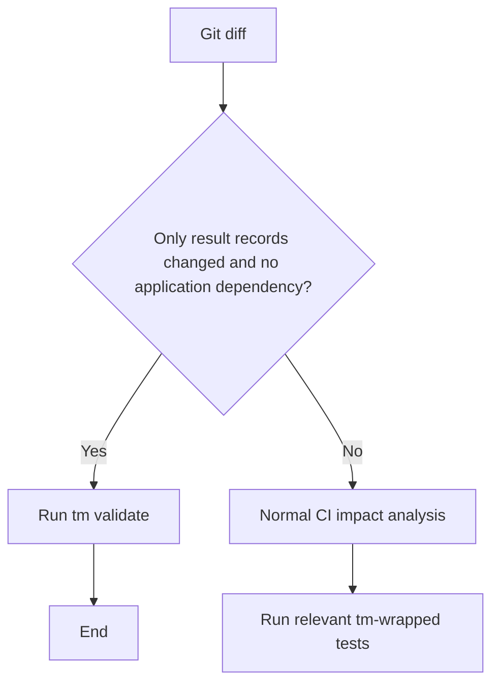
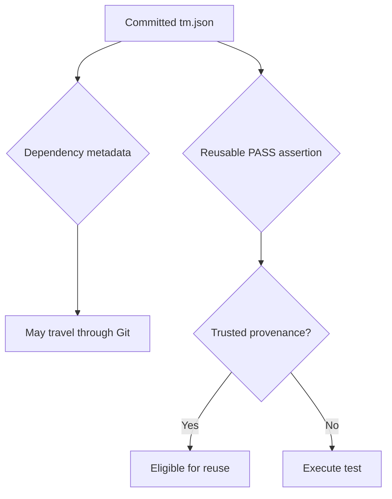
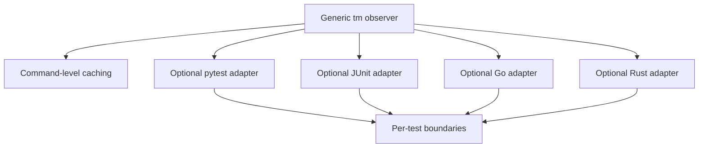
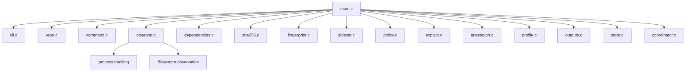
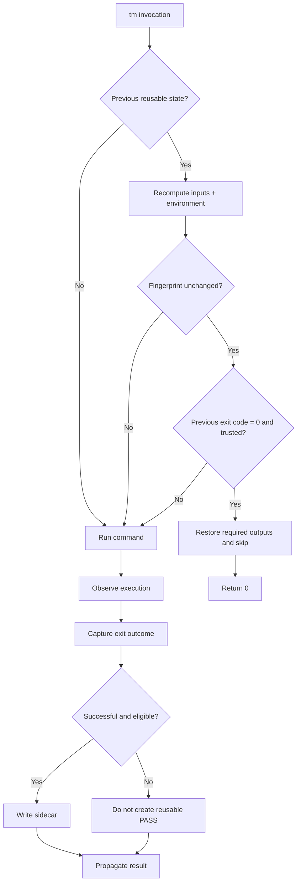

# tm — Test Memoization Utility

## Technical Specification

**Status:** Portable reuse design; implementation in progress
**Target implementation:** C, Linux-first  
**Primary purpose:** Language-agnostic memoization of successful test and verification commands  
**Invocation model:**

```bash
tm -- <test command>
```

Examples:

```bash
tm -- pytest tests/test_risk.py
tm -- go test ./pkg/risk
tm -- cargo test risk_score
tm -- ./gradlew test
tm -- ./tests/test_import.sh
tm -- ./build/unit_tests
```

---

# 1. Purpose

`tm` is a small, language-agnostic command-line utility that reduces unnecessary repeated test execution.

It runs an arbitrary test command, observes the files and execution context used by that command, records the resulting dependency fingerprint and process exit code, and reuses a previous successful result when the effective inputs have not changed.

The fundamental invariant is:

> If the command, its relevant inputs, and its execution environment are unchanged from a previous successful execution, rerunning the same deterministic test provides no additional information.

`tm` treats a successful execution as reusable only within an explicitly enabled verification profile. Success alone does not establish determinism or complete observation. Arbitrary commands can always run; only the supported subset can skip.

The product objective is **never execute the same successful verification twice**: once a trusted result for a complete effective-input fingerprint is available, every compatible local checkout, worktree, developer workstation, GitLab pipeline, and GitHub Actions workflow MUST reuse it. A new commit, branch, checkout path, producer, job ID, or CI provider alone MUST NOT create a new verification identity.

This is a reuse guarantee for available, trusted, eligible results, not an unconditional exactly-once execution claim. Changed effective inputs, failures, explicit `--force`, missing/corrupt evidence or required artifacts, revoked trust, and unsupported/nondeterministic inputs may require execution. Disconnected machines cannot discover each other's unpublished results. Concurrent cold misses require shared coordination (section 39). These limits MUST be visible in explain output rather than hidden behind a universal guarantee.

Sections below specify target behavior, not completed features. The first reusable release includes portable signed evidence, controlled execution profiles, and GitLab/GitHub/local acceptance cases. A profile establishes determinism, stable inputs, runtime coverage, and declared output behavior. Without an approved profile, commands run without authorizing reuse. Profiles may be checked in as data, but their exact digest and repository identity must be approved by operator-controlled trust configuration; an arbitrary branch cannot approve itself.



---

# 2. Goals

`tm` MUST:

1. Execute arbitrary test commands.
2. Determine success or failure from the actual child process outcome.
3. Observe runtime filesystem dependencies of the command and its descendants.
4. Persist immutable signed verification records indexed by portable command and result identity (section 7).
5. Hash relevant repository-controlled inputs using SHA-256.
6. Skip tests whose complete verification fingerprint matches a previously successful execution.
7. Return the same successful exit code to the caller when a test is skipped.
8. Preserve the original exit status when a test actually runs.
9. Work consistently across developer machines and CI/CD pipelines.
10. Allow sidecars to be committed to Git.
11. Ensure changes to `tm` metadata do not themselves invalidate application tests.
12. Provide metadata validation so CI can avoid broad testing for sidecar-only changes under section 23.
13. Default to rerunning whenever `tm` cannot establish that reuse is safe.
14. Be implemented as a small native utility, initially targeting Linux.
15. Require no changes to the test code itself.
16. Reuse checked-in authenticated results across worktrees and workstations without sharing private signing keys.
17. Use the same portable identities and evidence in GitLab, GitHub Actions, and local execution.
18. Retain multiple successful input states so switching branches and returning to a prior state does not discard reusable work.
19. Restore declared required artifacts on a hit and coordinate concurrent cold misses when a shared coordinator is configured.

---

# 3. Non-goals

The initial implementation MUST NOT attempt to:

- replace pytest, JUnit, Go Test, Cargo Test, Gradle, or other test frameworks;
- become a general-purpose build system;
- build a complete static dependency graph of the repository;
- understand source-code semantics;
- automatically determine database row-level dependencies;
- treat arbitrary external network state as cacheable;
- infer whether nondeterministic tests are logically safe to cache;
- replace CI orchestration;
- persist reusable failed results;
- determine individual test-case results inside a multi-test command unless an optional adapter provides those boundaries.

---

# 4. Core Model

A reusable verification result is defined by:

```text
verification =
    command
  + test identity
  + repository input state
  + declared environment state
  + execution semantics
```

The result of an actual execution is:

```text
verification fingerprint -> process outcome
```

Only a normal successful process exit is reusable.

For the first reusable release:

```text
exit_code == 0
```

means that the execution is eligible for reuse.

A previous non-zero exit code MUST NOT cause the next invocation to be skipped.

---

# 5. High-Level Execution Flow



Lookup MUST evaluate candidate manifests against current stable inputs; a candidate fingerprint is not accepted just because its file name matches. Publication transport and coordination are supervisor activity, not child network dependencies.

---

# 6. Repository Root

`tm` MUST determine the root using explicit `--root`, otherwise the closest ancestor with a `.git` file or directory, otherwise the working directory. `--root` is a target 0.1 option, not yet implemented.

The working directory MUST be within the root for reuse. Persist repository paths relative to the root, using `/`, with `.` only for the root itself. Reject absolute paths, NUL, empty components, `..`, and ambiguous encodings. Version 0.1 supports UTF-8 paths; unsupported names cause RUN without reusable state.

Lexical normalization MUST NOT erase symlink dependencies. Resolve accesses using each process's actual cwd, root, and directory descriptors. Record the symlink chain and classify the resolved destination; a link under the repository does not make an external target a repository input. Root relocation must not by itself change relative input names. Absolute user-specific paths MUST NOT be persisted.

---

# 7. Portable Result Locations

The portable Git layout is:

```text
.tm/results/<command-id>/<verification-id>/<record-id>.tm.json
.tm/profiles/<profile-name>.json
```

Each ID is its SHA-256 digest without the `sha256:` prefix. `command-id` indexes invocation variants; `verification-id` identifies effective inputs; `record-id` hashes the signed envelope's canonical bytes. Several producers may sign the same verification without changing its verification identity. Records are immutable: union directories when merging branches, rather than overwriting a single latest-success file. Deduplicate envelopes by record ID.

Lookup searches checked-in records, the user's local content store shared across worktrees, then configured shared stores. Merge candidate sets; neither lookup order nor an unsigned index establishes trust. Local indexes are rebuildable hints. Bound parsing and traversal; on incomplete lookup report that a result may be unavailable and either run or wait according to policy.

A stable `repository_id` approved by the operator namespaces all records and stores. It is independent of remote URL, absolute checkout path, branch, and Git worktree internals. Mirrors on GitLab and GitHub use the same ID only by explicit trust configuration. Forks cannot claim a trusted repository's identity merely by copying its profile.

State destinations MUST reject traversal and symlink escapes. Portable records contain no user-specific absolute paths. Required large artifacts may live in content-addressed stores; Git records remain small. A self-contained offline hit requires the signed record plus all required artifact blobs and an acceptable trust snapshot.

---

# 8. Portable Signed Record Format

Use a closed, versioned JSON schema. Schema/semantics version 2 supersedes the previous local-HMAC draft; version 1 records MUST NOT authorize portable reuse. The following is schematic; placeholders are not valid persisted digests or signatures:

```json
{
  "payload": {
    "schema_version": 2,
    "tm_semantics_version": 2,
    "repository_id": "example-project",
    "trust_epoch": 1,
    "identity": {
      "command_fingerprint": "sha256:<64 lowercase hex digits>",
      "working_directory": "."
    },
    "inputs": [
      {"path": "tests/test_risk.py", "kind": "file", "sha256": "sha256:<64 lowercase hex digits>"}
    ],
    "environment": {
      "profile_digest": "sha256:<64 lowercase hex digits>",
      "runtime_digest": "sha256:<64 lowercase hex digits>",
      "context_digest": "sha256:<64 lowercase hex digits>"
    },
    "outputs": [],
    "verification_fingerprint": "sha256:<64 lowercase hex digits>",
    "result": {"exit_code": 0, "signal": null}
  },
  "attestation": {
    "algorithm": "ed25519",
    "key_id": "sha256:<public-key digest>",
    "signature": "<base64 signature>"
  }
}
```

Store RFC 8785 JCS UTF-8 bytes plus one LF; hash/sign the JCS bytes without the LF. Reject duplicate/unknown keys, invalid Unicode, floats, unsupported versions, invalid paths/digests, and duplicate records. Integers are nonnegative and bounded by `2^53 - 1`. Sort dependencies by UTF-8 `(path, kind)`, outputs by UTF-8 path, and preserve argv order. Never normalize Unicode in paths or argv. See [RFC 8785](https://www.rfc-editor.org/rfc/rfc8785).

Input variants are `file` (`path`, `kind`, `sha256`), `exists` (`path`, `kind`, boolean `state`), `directory` (`path`, `kind`, membership `sha256`), and `symlink` (`path`, `kind`, relative `target`). Unsupported metadata observations remain ineligible unless supplied by the enforced profile view (section 13). Output entries are `path`, `kind` (`file` or `directory`), `mode` (permission bits only), and, for files, `sha256` and byte `size`. No symlinks, device nodes, hardlink semantics, or traversal are allowed in initial output manifests.

Do not persist raw argv/environment, private keys, secrets or their guessable hashes, hostnames, usernames, PIDs, temporary paths, pipeline/run IDs, branch names, or timings. Public-input hashes are permitted; secret-bearing inputs are ineligible for publication (section 30). The signature covers the complete payload, including inputs, outputs, zero outcome, repository, and trust epoch. Separate redacted provenance logs may contain operational details but never determine equivalence.

---

# 9. Process Outcome

The authoritative result MUST be the actual child-process outcome.

Normal completion:

```json
{
  "exit_code": 0,
  "signal": null
}
```

Failure:

```json
{
  "exit_code": 1,
  "signal": null
}
```

Signal termination:

```json
{
  "exit_code": null,
  "signal": 11
}
```

`tm` MUST NOT persist a second authoritative status such as:

```text
PASS
FAIL
SUCCESS
ERROR
```

These states MAY be derived for display.

Interpretation:

```text
exit_code == 0       successful
exit_code != 0       unsuccessful
terminated by signal unsuccessful
```

---

# 10. Exit-Code Transparency

When a test actually executes, `tm` MUST preserve normal numeric exit codes. For signal termination it MUST return `128 + signal`; it does not promise to terminate itself with the same signal.

```text
pytest exits 0
-> tm records exit_code=0
-> tm exits 0
```

```text
pytest exits 2
-> tm records exit_code=2
-> tm exits 2
```

When a successful result is reused:

```text
matching trusted fingerprint
+ previous exit_code = 0

-> test is not executed
-> tm exits 0
```

Existing CI systems can consume these numeric outcomes; enabling trusted reuse additionally requires section 26 configuration.

---

# 11. Input Discovery

`tm` MUST discover inputs dynamically by observing execution of the command and its descendants.

The test itself does not need to declare its dependencies.

The first execution acts as discovery.



---

# 12. Process-Tree Tracking

The observer MUST attach before the first child exec and follow every thread and descendant across fork, vfork, clone/clone3, execve/execveat, and posix_spawn's underlying operations. It MUST track descriptor duplication, inheritance, close, cwd changes, and thread-shared descriptor/cwd state.

Completion of the direct child is insufficient for publication. All traced descendants must be accounted for and finished; a daemon that outlives the direct child makes the run non-reusable. Version 0.1 then detaches safely and returns the direct child's outcome without waiting indefinitely. Descendant failures handled by the parent do not independently redefine the command's outcome.

Trace loss, unsupported ABI transitions, failed attachment, privilege transitions, escaped processes, or unresolved process state make the entire invocation non-reusable. Preserve child signal delivery, and handle interruption of the wrapper without publishing success. Existing signal return-code conversion does not imply full signal forwarding is implemented.

---

# 13. Filesystem Dependency Types

All supported input kinds are mandatory for reusable runs:

- **File contents:** hash the bytes of regular files read, executable/interpreter files, and file-backed mappings. Opening a file for potential reading may conservatively count as a content dependency.
- **Existence:** record positive and negative probes, including unsuccessful executable search candidates. Only absence explained by `ENOENT`/`ENOTDIR` can be modeled as a negative existence dependency; permission and other errors require an equivalent modeled condition or no reuse. Record path-resolution dependencies as well.
- **Directory membership:** hash a JCS array of `[name, type]` pairs sorted by UTF-8 name bytes (`type` is `file`, `directory`, or `symlink`; unknown/special types disable reuse), excluding `.` and `..`. A partial enumeration conservatively depends on the entire directory. See section 22 for metadata visibility.
- **Symlinks:** track each traversed link, its target text, and the final target dependency. Cycles, unresolved targets, external escapes, or nonportable target text prevent reuse unless covered by the controlled runtime.

`stat`, `access`, and related calls expose more than existence. If a command can observe unmodeled size, timestamps, mode, ownership, inode, permissions, xattrs, or directory ordering, the MVP MUST mark it non-reusable. A backend may instead enforce a canonical metadata view and bind its full rules in the approved profile: deterministic modes/ownership, timestamps, inode identities, directory ordering, and supported return values/errors. Reuse then requires that identical content and profile imply identical exposed metadata. Partial normalization is insufficient; native unmodeled observations still prevent reuse. Merely hashing file contents does not validate those observations.

Tracked and untracked files are equally relevant. Git tracking status and `.gitignore` MUST NOT exclude observed inputs. `.git` itself is an ordinary dependency if the child reads it; unsupported or volatile Git state causes RUN.

---

# 14. Required Linux Observation Baseline

Use `ptrace` for the first backend on Linux x86-64 native ABI. Attach before exec; enable syscall entry/exit observation and fork, vfork, clone, exec, and exit event tracking. Other architectures/ABIs execute uncached until separately supported. `LD_PRELOAD` alone is insufficient because commands may bypass it. The Linux [ptrace manual](https://man7.org/linux/man-pages/man2/ptrace.2.html) defines the required process event mechanisms.

The backend MUST maintain an explicit syscall classification table for the supported ABI. Each syscall must be modeled, proven irrelevant to reuse, or mark the invocation non-reusable. Unknown calls MUST NOT silently pass as safe.

Coverage includes:

- open/openat/openat2, reads and vectored/positioned reads, executable loading, mmap and file-backed mappings;
- stat/fstat/newfstatat/statx, access/faccessat/faccessat2, readlink/readlinkat, getdents/getdents64;
- chdir/fchdir, dup variants, fcntl descriptor operations, close/close_range, descriptor inheritance;
- writes, truncation, rename, unlink, links, directory creation, permission changes, and writable mappings for mutation detection;
- socket creation/use and all process creation/exec paths.

`io_uring`, unmodeled ioctls, mount/root/namespace changes, external shared memory/IPC, descriptor passing, device access, and any other unmodeled input channel make the execution non-reusable. Inherited descriptors other than controlled stdin/stdout/stderr are unsupported in 0.1. Input from a terminal, pipe, or uncontrolled stdin forces RUN; use `/dev/null` for eligible commands. Stdout/stderr writes are permitted; replay is governed by the output contract in section 38.

Observer setup failure MUST run the command once without caching. Failure after launch MUST preserve the running invocation where possible and revoke eligibility; it MUST NOT restart a command that may already have performed effects.

---

# 15. Input Classification and Runtime Identity

Repository inputs are fingerprinted individually. External mutable inputs are non-cacheable in version 0.1. Exceptions are files in a controlled, read-only runtime whose full content is identified by an immutable digest in the trusted execution profile.

Interpreter/compiler version strings and a container image tag are insufficient. An OCI image digest can identify image content, but not writable layers, bind mounts, host configuration, kernel state, or external services. A runtime provider must ensure the digest covers the executable, interpreter, shared libraries, loader configuration, packages, and system data actually used. Host caches, home directories, `/proc`, `/sys`, and mutable mounts are unsupported unless their input semantics are explicitly covered. `/dev/null` is the only initial device exception.

The profile MUST define runtime digest, observer ABI and semantics, stable workspace policy, permitted input roots, filesystem/metadata capabilities, deterministic-command declaration, scratch/output contract, and absence of undeclared external effects. It MUST be operator controlled; repository changes cannot weaken it. Missing or unverifiable coverage means RUN. Version 0.1 may provide fewer cache hits on ordinary developer hosts than in controlled CI; correctness takes priority over coverage.

---

# 16. Test Source and Executables

The executed binary, script/interpreter chain, and loaded test sources MUST contribute through observed inputs or the controlled runtime. `tm` cannot infer a primary test file from an arbitrary argv.

Use target option `--input <relative-file>` for an additional known input not read directly (for example, source corresponding to a generated binary). Explicit input files MUST be hashed before launch and validated under section 38; missing or unsupported inputs disable publication, but the command still runs. Transitive input discovery remains the observer's responsibility.

---

# 17. Portable Command Identity

Commands are exact argument vectors; preserve empty arguments and launch without implicit shell interpretation. The approved profile launches in a canonical workspace such as `/workspace`, with a relative cwd and fixed runtime paths. Relative argv is preferred. Never rewrite arbitrary argument substrings just for hashing; normalization must also describe the actual executed command.

Define `command_fingerprint = SHA256("tm-command-v2\0" || JCS({repository_id, argv, working_directory, execution_options}))`, formatted as `sha256:<lowercase hex>`. `execution_options` contains sorted/deduplicated additional input declarations and output declarations. Execution-profile identity belongs in the verification fingerprint. `--force`, `--explain`, transport endpoints, signing identity, physical root, and coordination mode are not command inputs. `\0` means one NUL byte and `||` byte concatenation.

There is no workstation-specific key in any reusable identity. Public argv must be declared non-secret by the profile; secret-bearing argv disables shared publication, because hashing a low-entropy secret does not hide it. Non-UTF-8 argv also disables reuse in the initial release.

Changing a command flag, argument boundary, relative cwd, declared input, or output contract changes identity. Revalidate PATH misses, selected executable, interpreter chain, and runtime coverage. Absolute host paths cause RUN unless the enforced execution view gives them a common actual meaning on all consumers.

---

# 18. Verification Fingerprint

Define:

```text
verification_fingerprint = SHA256(
    "tm-verification-v2\0" || JCS({
        schema_version, tm_semantics_version, repository_id,
        identity, inputs, environment
    })
)
```

Output declarations participate through command identity/profile; produced output bytes are signed evidence, not pre-execution inputs. The result, signature, key ID, trust epoch, transport, physical checkout root, branch, commit ID, and CI provider are excluded from equivalence. Trust epoch still gates acceptance independently. Hash the complete signed envelope separately for `record-id`.

A Git commit is not an input identity: unrelated commits should hit, while changed observed files, missing-file probes, runtime, or delivered environment must miss. A dependency on `.git` or commit data remains a real input if visible to the command; portable profiles should hide it or pass required Git-derived values explicitly.

Recompute a candidate's input manifest in a stable view and reconstruct its fingerprint; never trust a supplied hash alone. Keep individual input hashes for diagnostics. Changes to discovery/canonicalization rules bump semantics version and require compatible evidence. Fingerprints provide content identity, not authenticity.

---

# 19. Skip Decision

`tm` MAY skip execution only when all of the following are true:

1. a valid sidecar exists;
2. its schema version is understood;
3. its test/command identity matches;
4. its previous execution exited normally;
5. its previous exit code was `0`;
6. every recorded input remains equivalent;
7. the execution environment identity remains equivalent;
8. no policy condition requires forced execution;
9. a permitted producer signature verifies under the current repository/profile trust policy and revocation rules (sections 26–27);
10. the current trusted profile still establishes eligibility, input stability, and runtime coverage;
11. current inputs are read from one stable state, not a mixture of concurrent revisions;
12. required output blobs are available, verified, and restored successfully;
13. no known invalidation or in-progress forced attempt blocks this verification.

When these conditions hold and execution is not forced, `tm` MUST reuse the result. If one candidate fails validation, continue evaluating other available candidates; an invalid or missing record cannot suppress a valid alternative. Only after no accepted candidate remains does normal policy execute (strict coordination may wait or fail).

---

# 20. Failures, Forced Runs, and Invalidation

Failures never authorize skips. Successful records are immutable historical evidence; do not destroy unrelated successful fingerprints when a command fails on changed inputs.

Before an actual run, durably mark an attempt in the local state shared across worktrees for its repository/command/context and candidate fingerprint, when known. An interrupted, failed, or ineligible attempt blocks reuse of matching older evidence locally until a new eligible success or explicit operator resolution. A failure for input state B does not invalidate proven state A. Where discovery is incomplete, conservatively block the matching command/context until the affected fingerprint can be established.

A forced failure with the same effective fingerprint as a prior success indicates nondeterminism or faulty observation. Quarantine that fingerprint and report the contradiction; do not automatically resurrect the old success on the next invocation. Publish an authenticated invalidation through the trust/coordinator service when available. New success may supersede an ordinary failed attempt, but clearing a contradictory-result quarantine requires explicit operator resolution, normally a corrected profile/semantics/trust epoch.

A signed invalidation binds repository ID, target fingerprint (or command/context for an incomplete attempt), monotonic revision, reason code, and optional superseding policy epoch. Only issuers authorized to invalidate may affect shared trust. Shared consumers apply the newest trusted invalidation state. Local failures always block locally even when the producer is not authorized to issue shared invalidations.

Disconnected clones cannot learn a later failure or key revocation immediately. Offline reuse is relative to an operator-approved trust snapshot; policies requiring live freshness MUST wait or run without reuse when it cannot be obtained. This limitation is explicit, not an assertion of globally instantaneous revocation. Storage failures prevent publication and are reported without replacing a collected child outcome.

---

# 21. Relearning Dependencies

Whenever a test actually executes, `tm` MUST rebuild its observed dependency set.

Example:

Previous execution:

```text
test
-> foo.py
-> bar.py
```

New `foo.py` introduces:

```text
new_module.py
```

Because `foo.py` changed, the previous verification is invalidated. The test runs and `tm` relearns:

```text
test
-> foo.py
-> bar.py
-> new_module.py
```

This allows the dependency set to evolve naturally.

---

# 22. Metadata Isolation

The portable execution profile MUST hide reserved `.tm` metadata from the child, including directory listings, while the supervisor reads and writes it outside the child view. Apply the same view on first execution and every subsequent invocation. This makes checked-in results independent of the verification inputs and prevents sidecar commits from invalidating tests.

An observer-only fallback that cannot hide metadata must record actual visibility; child access to `.tm` or enumeration exposing it makes that run ineligible. Never remove visible names merely from the hash. Only reserved directories are metadata; arbitrary files ending in `.tm.json` remain ordinary inputs. Profiles themselves affect the fingerprint via their approved digest, even though their storage directory is hidden.

---

# 23. Git and CI Behavior

Sidecars are intended to be committed to Git.

This allows successful dependency knowledge to travel between:

- developers;
- branches;
- CI pipelines;
- clean environments.

CI SHOULD avoid broad test execution for changes consisting exclusively of `.tm/results/**`, provided the application does not consume it. This is repository CI policy; the wrapper cannot enforce pipeline triggering. If tests consume metadata, section 22 applies and CI must retain the relevant tests.

Profile changes under `.tm/profiles/**` are execution-policy changes and MUST go through approval and affected-command fingerprint evaluation. They are not result-only metadata.

Repository CI SHOULD classify:

```text
.tm/results/**
```

as verification metadata.

A result-record-only change SHOULD produce:

```text
tm validate
```

rather than normal application testing.



---

# 24. `tm validate`

Target command: `tm validate [--root DIR] [--trust-policy FILE] [--require-trust]`. Scan `.tm/results/*/*/*.tm.json` without running tests or following symlinks. Validate closed schema, canonical encoding, safe paths, digest syntax, array ordering, zero result, filename IDs, and reconstructed fingerprint. Verify signatures with available policy and report trusted/untrusted/revoked/unknown separately; do not claim current input freshness merely from structural validity.

Return 0 for valid records, 1 for invalid records (or unacceptable trust with `--require-trust`), and 125 for usage/I/O errors. An empty set is structurally valid. Without `--require-trust`, a well-formed record by an unknown key may pass structure checks but must be labeled untrusted. A cryptographically invalid signature for a known key is invalid, not merely unknown. Validation never signs, executes, or imports a trust root from candidate metadata.

---

# 25. Trust and Provenance

Committed verification state creates a security issue.

A contributor MUST NOT be able to forge a sidecar that causes CI to skip an unverified change.

Dependency metadata and verification trust MUST therefore be considered separately.



The assertion:

```text
fingerprint ABC was successfully verified
```

MUST have authenticated provenance before reuse.

---

# 26. Portable Trust Model

The first reusable release MUST authenticate portable results with public-key signatures. Consumers need only approved public keys; private signing keys never travel with Git records, worktrees, artifacts, or caches. A fresh clone with a checked-in valid record and approved trust policy can skip immediately without running locally first.

Operator-controlled trust policy maps stable repository IDs to approved profile digests, public keys/producer roles, allowed semantics, minimum trust epoch, and revocations. The same policy may approve local developer, GitLab, and GitHub producers. Consumers may be stricter: a CI policy need not accept every developer's key. Cross-machine reuse succeeds only when the producing key/profile is approved by the consumer.

Policy can be distributed as an administrator-managed file or a signed bundle verified by a root provisioned outside the checkout. A checked-in profile/key list cannot grant itself authority. Mirrors/worktrees share repository identity through this policy, not inferred remote URL equivalence. Trust-policy updates do not change input fingerprints, but may make old results unacceptable.

A producer signs only results established by its trusted supervisor after complete eligible observation. The signer must not be an API that signs arbitrary JSON submitted by a test. For untrusted PR/MR code, isolate the supervisor, signing capability, policy, transport credentials, and evidence channel from the child. Putting a signing key in an environment variable of the same unrestricted job is insufficient. Verification-only jobs can consume trusted records without access to signing credentials; uncached executions in such jobs do not become trusted shared results automatically.

Local users may provision a key and approve it for their own worktrees/workstations. Team-wide reuse of those results requires team approval of that public key. No private key sharing is necessary. An offline accepted record remains valid relative to the provisioned trust snapshot; live revocation requires connectivity. A consumer records the highest authenticated trust revision it has seen and rejects rollback below its configured/local minimum.

| Consumer | Required behavior |
| --- | --- |
| Second local worktree | Reuse matching checked-in or user-store records under the same approved repository/profile. |
| New developer workstation | Reuse with approved public keys and compatible runtime; no prior local execution required. |
| Fresh GitLab/GitHub job | Reuse matching checked-in/downloaded evidence; job ID/provider does not confer trust or change identity. |
| Untrusted PR/MR | May verify approved evidence; cannot mint trusted results unless an isolated trusted producer executes it. |
| Edited record or copied record from another repository | Reject signature/scope mismatch and execute. |

---

# 27. Required Signed Attestations

Use Ed25519 as specified in [RFC 8032](https://www.rfc-editor.org/rfc/rfc8032), via a maintained cryptographic implementation. Define:

```text
signature = Ed25519.Sign(private_key, "tm-result-v2\0" || JCS(payload))
key_id = "sha256:" + hex(SHA256(raw_32_byte_public_key))
record_id = "sha256:" + hex(SHA256(JCS({payload, attestation})))
```

Encode the 64-byte signature using standard padded base64. Enforce exact key/signature sizes and strict verification. Authenticate every payload field, including output manifest, repository ID, trust epoch, and normal zero outcome. Attestation algorithm/key ID are checked against the fixed schema and trusted key mapping; never accept an embedded key as its own authority.

Signatures are required for portable reuse in the first release. A consumer rehashes inputs and checks runtime/profile even after signature verification. Additional issuers may create another immutable envelope for the same payload; producer identity does not fragment the verification key. Key revocation, profile revocation, and minimum epochs live in signed/operator trust state. Do not use signature timestamps as execution inputs or require re-signing solely because a record is old.

---

# 28. External Network State

Version 0.1 MUST mark a run non-reusable on any socket creation or attempted socket communication, even when the call fails. This deliberately conservative rule covers DNS, TCP/UDP, IPv4/IPv6, loopback, Unix-domain sockets, netlink, listeners, and local services. Inherited sockets or passed descriptors also prevent reuse. Socket-backed IPC inside the process tree is not exempt in the MVP.

Detect socket/socketpair, connect, bind, listen, accept variants, send/receive variants, and socket I/O through read/write or other transfer operations. Reading an external service cannot be made safe by observing only its endpoint. No `--external-input` value overrides this rule in version 0.1.

---

# 29. Declared Additional Inputs

Version 0.1 supports repeatable `--input <relative-file>` for regular repository files. Declarations join observed dependencies, are canonicalized, deduplicated, and contribute to identity and verification. They cannot remove observed dependencies or bypass eligibility rules.

Logical `--external-input name=digest` is deferred. A future provider must demonstrate that all service state consumed by the run is bound to that digest before network reuse can be enabled. A caller-supplied database fixture hash alone does not prove the live database matches it.

---

# 30. Portable Environment and Execution Context

Portable profiles construct a clean child environment before exec. Start empty, add profile constants and explicitly permitted non-secret caller values, and fingerprint the complete resulting environment. Remove all other inherited values from the actual child, not just from hashing. Canonicalize sorted UTF-8 `[name, value]` pairs; unset and empty differ; duplicate names or unsupported encodings disable reuse.

A portable profile fixes actual workspace/runtime paths, HOME/TMPDIR, PATH, locale, timezone, stdin (`/dev/null`), descriptor/TTY behavior, umask, effective identity, and resource limits. Use the same profile locally and in both CI systems. Host paths are mounted into canonical execution paths; merely renaming them in metadata is insufficient. Public context is `context_digest = SHA256("tm-context-v2\0" || JCS({environment, execution_context}))`.

`execution_context` includes actual OS/architecture/ABI, kernel identity, CPU features, credentials/groups, limits, umask, and standard descriptor policy unless a versioned profile backend enforces a common observable value. Differences cause separate fingerprints. A container digest alone does not standardize the host kernel or CPU. For reuse across heterogeneous hosts, provide a common VM/runtime contract or prove and enforce the allowed equivalence; do not silently ignore machine variation. Initially only compatible Linux x86-64 profiles share results; other host OSes may invoke that profile through a Linux VM.

GitLab job/pipeline IDs, tokens, checkout paths and GitHub run IDs, tokens, event/workspace paths remain supervisor-only. They must not reach the child unless explicitly declared as real inputs; if delivered, their values change equivalence. Both platforms document such injected variables: [GitLab variables](https://docs.gitlab.com/ci/variables/predefined_variables/) and [GitHub variables](https://docs.github.com/en/actions/reference/workflows-and-actions/variables). CI transport uses those credentials outside the observation boundary.

Portable publication accepts only profile-declared public argv, environment, input paths, and file contents. A secret that affects the result makes shared publication ineligible in the initial release. Plain SHA-256 does not protect guessable secrets; a common HMAC key would give every consumer unnecessary secret material. Do not persist either. Supervisor signing/storage credentials are excluded from the child's environment and fingerprint. Secret-aware private caching is deferred.

No per-workstation randomness, signing key, issuer, or cache location enters command/context fingerprints. Changing an explicitly delivered public variable MUST invalidate reuse identically on every machine.

---

# 31. Time, Randomness, and Determinism

Detected clock, entropy, uncontrolled device, or other nondeterministic input makes the MVP run non-reusable. This includes time syscalls, getrandom, and reads of random devices.

Syscall tracing cannot prove the absence of nondeterminism: time can be read through the vDSO, and programs can use CPU instructions or scheduling-dependent behavior. See the Linux [vDSO manual](https://man7.org/linux/man-pages/man7/vdso.7.html). A successful trace MUST NOT be described as proof of determinism.

Reuse additionally requires the trusted profile's explicit assertion that the command's result is deterministic under its controlled inputs/context. Flaky tests and tests whose pass/fail depends on uncontrolled time, randomness, concurrency, or resource availability are ineligible. Without that assertion, run normally. The portable backend enforces its declared execution contract; stronger automatic guarantees against all nondeterminism remain future work.

---

# 32. Generic Command Granularity

Without framework-specific integration:

```bash
tm -- pytest tests/
```

represents one verification command.

Its sidecar means:

> The entire command completed successfully with these observed inputs.

Likewise:

```bash
tm -- go test ./...
```

is one cache unit.

This is sufficient for the generic implementation.

---

# 33. Optional Framework Adapters

Future adapters MAY improve granularity.

Examples:

- pytest;
- JUnit;
- Go test;
- Cargo test.

Adapters could notify `tm` of individual test boundaries:

```text
TEST_START identifier
TEST_END identifier result
```

The low-level dependency observer remains generic.

Adapters SHOULD only supply:

- test identity;
- start boundary;
- end boundary;
- optional framework result metadata.

They SHOULD NOT implement a separate dependency-discovery mechanism.



---

# 34. CLI

The existing wrapper contract remains `tm [--force] [--explain] -- COMMAND [ARGUMENT ...]`, with `--help`/`-h`. Unknown/incomplete invocations return 125; argv after the mandatory `--` passes without shell interpretation; repeated boolean flags are idempotent.

Target commands for the first portable release (not claims of current implementation):

```text
tm [--root DIR] [--profile FILE] [--trust-policy FILE] [--input FILE] [--output PATH] [--force] [--explain] -- COMMAND [ARGUMENT ...]
tm validate [--root DIR] [--trust-policy FILE] [--require-trust]
tm clean [--root DIR] [--records]
```

`--input` and `--output` are repeatable, canonical relative declarations; repeated singleton options or missing values return 125. An approved profile may be selected by external operator configuration instead of a flag. Profiles are declarative versioned data, never executable checkout hooks.

Profile schema must include repository ID, runtime/backend contract, clean environment construction, path mappings, stable input policy, observation capabilities, determinism assertion, scratch roots, output declarations, and privacy classification. Operator policy separately supplies trusted keys/epochs, signing provider, read/write result stores, and coordination mode. Transport addresses and credentials do not affect equivalence. Repository-provided profiles must match an approved digest. Missing approved configuration means uncached execution; an explicit malformed/unapproved profile is a usage/configuration error (125), not permission to execute under a silently different environment.

Remote transport APIs and profile field serialization must be frozen with golden fixtures before implementation enables portable hits. Their behavioral contracts are normative here.

---

# 35. `tm --force`

Example:

```bash
tm --force -- pytest tests/test_foo.py
```

MUST execute the command regardless of cached state.

Before execution record an attempt under section 20; publish a new signed record only after eligible success. A contradictory forced failure quarantines matching success. Force explicitly overrides the no-repeat objective.

Version 0.1 MUST also support the exact value `TM_FORCE=1` (not yet implemented); other values have no forcing effect:

```bash
TM_FORCE=1
```

Use cases:

- debugging;
- nightly exhaustive testing;
- cache-validation runs;
- confidence checks;
- investigating suspected false skips.

---

# 36. `tm --explain`

`tm --explain` MUST identify RUN, SKIP, WAIT, or configuration failure, the candidate verification ID/source, trust decision, and relevant invalidation or missing evidence. Do not print secret argv or values. Normal output may remain terse.

Example skip:

```text
SKIP tests/test_score.py

Reason:
  previous successful verification fingerprint matches

Fingerprint:
  sha256:8a84...
```

Example execution:

```text
RUN tests/test_score.py

Reason:
  src/risk/scoring.py changed

Previous:
  sha256:abc123...

Current:
  sha256:def456...
```

Other possible reasons include:

```text
no available signed result
required output blob missing
producer not trusted
trust freshness unavailable
coordinator unavailable; duplicate execution possible
command changed
test file changed
environment changed
external network dependency
previous execution failed
sidecar untrusted
tm semantics changed
forced execution
```

---

# 37. `tm clean`

`tm clean [--root DIR]` removes rebuildable local indexes and staged partial downloads for this repository. It MUST preserve checked-in results, public trust policy, private signing keys, revocations/quarantines, and completed content-addressed evidence by default. Cleanup must not silently turn a known failure into an accepted old success.

Explicit `--records` additionally removes local `.tm/results` files, including tracked files, but never other repositories' records or shared-store content. It does not revoke signatures elsewhere. Return 0 on success, 125 on usage/I/O failure; never run tests or follow symlinked state paths. Serialize against publication. Global retention/deletion is an operator storage policy and may make unavailable evidence require future execution.

---

# 38. Stable Inputs, Scratch Space, Outputs, and Publication

A result must describe bytes actually consumed. Post-run hashing and equal before/after hashes do not exclude change-and-restore races. The approved profile must provide an immutable input/runtime view or an enforced exclusion of concurrent writers. An advisory `tm` lock does not exclude editors. Snapshot untracked inputs as well as tracked files; disable publication if stability cannot be established.

Provide empty private scratch roots at canonical paths on every invocation. Child writes within those roots are allowed, and files created there are derived state, not independent inputs. They must start empty and cannot read an existing host cache. Writes to repository/runtime inputs, external state, or undeclared writable locations invalidate reuse. A write is not disposable merely because it is called a cache.

Declare required output paths in the profile/`--output` contract. The backend maps them to initially empty writable roots disjoint from inputs and metadata. After success, enumerate the complete output tree, record files/directories, modes, sizes, and hashes, and store immutable blobs by SHA-256. Sign the output manifest with the result. Unsupported entries or effects prevent publication. Persistent external effects remain ineligible.

On a hit, fetch and verify all required blobs before changing destinations; safely stage the complete output tree, remove stale entries only inside explicitly owned output roots, and atomically replace each owned root. Refuse symlink escapes or conflicting input paths. Do not return a successful hit until every declared root is restored. Multi-root restoration is not one filesystem transaction; on interruption, the next invocation verifies/restores all roots again before reporting success. Missing/corrupt blobs or restoration failure means no successful hit: repair from another source, or execute if safe; unrecoverable destination errors return 125 before launch. Stdout/stderr replay is optional and not a required artifact unless explicitly captured under the profile.

Publication order: finish all descendants and validate eligibility; durably store output blobs; create and sign the canonical payload through the trusted supervisor; atomically publish the envelope via temporary-file/fsync/rename; update rebuildable indexes last. A partial upload or index entry is never evidence of success. Local and remote stores accept idempotent content-addressed writes. A crash before publication may lose a completed computation and require a rerun; availability cannot promise exactly-once recovery.

Record publication faults preserve a collected child exit status and are reported as lost reuse opportunities. Checked-in results must be committed/distributed to reach other disconnected consumers; `tm` does not automatically commit or push. Shared-store publication can make evidence available immediately between independent pipelines.

---

# 39. Concurrent Reuse and Execution Coordination

Local runs use a lock keyed by repository ID, portable command identity, and context/profile in a user store outside worktrees. Hold it across lookup, attempt registration, execution, and publication. After acquiring any lock, repeat lookup so a waiting runner uses the result just published by its predecessor. Different input revisions may contend; this is acceptable for the initial implementation.

Across machines, checked-in files and cache uploads alone cannot prevent simultaneous cold executions. Support an optional provider-neutral coordinator shared by GitLab, GitHub, and local clients. It issues an exclusive execution slot keyed by `(repository_id, command_fingerprint, profile_digest, context_digest)`; use this conservative key because the final dynamic dependency manifest is unknown before execution. All participating runners re-query the shared result index after acquiring the slot, recompute manifests against their own inputs, and skip if any now match. Do not key by pipeline/branch/provider or whole commit.

Coordinator operations are acquire/wait, renew, complete with signed record ID, and fail/quarantine. Use durable ownership and monotonically increasing fencing tokens; storage publication must reject stale tokens. Only authorized producers may publish result references or invalidations. The coordinator does not authenticate successful computation by itself; verify signatures and inputs as usual.

Two explicit policies:

- **Available (default):** on coordinator outage or lost lease, allow uncached/independent execution with a diagnostic that duplicates are possible. Fencing prevents stale publication but cannot prevent an isolated old process from still running.
- **Strict coordination:** wait or return 125 before launch when ownership cannot be established. After an owner is lost, do not start a replacement until the previous execution is confirmed stopped. This trades availability for avoiding overlapping runs; a crash after success but before publication may still require recomputation.

No disconnected or partition-tolerant exactly-once claim is made. With healthy coordination, stable inputs, and durable publication, concurrent equivalent requests execute once and waiters reuse. Forced runs deliberately bypass result reuse but still acquire execution ownership.

---

# 40. SHA-256

SHA-256 MUST be the standard content hash for schema version 2.

Format:

```text
sha256:<hex>
```

Hash algorithms MAY become versioned later.

---

# 41. Performance

`tm` only provides value if:

```text
cost of checking inputs + fetching/restoring required outputs << cost of rerunning tests
```

Potential future optimizations include:

- cache file hashes using inode/mtime/size;
- parallel hashing;
- repository-level content index;
- reuse Git object hashes where safe;
- aggregate directory fingerprints;
- memory-mapped metadata database.

These optimizations MUST NOT weaken correctness.

The initial implementation MAY hash all recorded repository inputs directly. Retaining available signed evidence and required blobs maximizes reuse; pruning or evicting the only copy necessarily risks recomputation. Report missing evidence distinctly from changed inputs.

---

# 42. Git Optimization

Tracked repository files already participate in Git object identity.

A future implementation MAY use Git information to accelerate change detection.

However, the canonical `tm` verification state SHOULD remain explicitly defined rather than implicitly depending on Git implementation details.

Git SHOULD be treated as an optimization source, not the trust model.

---

# 43. Result Changes and Test Impact Analysis

Impact analyzers for GitLab, GitHub Actions, and local automation SHOULD classify `.tm/results/**` as generated verification evidence. A result-only diff can run `tm validate --require-trust` without triggering unrelated application tests. Invalid/untrusted records do not certify application behavior; normal test selection applies whenever source/input changes also exist.

Do not exclude all `.tm/**`: changes to `.tm/profiles/**` can alter execution semantics and must be approved and evaluated as profile changes. Metadata consumed by the application also remains a real dependency unless the profile hides it. Trust configuration cannot be weakened by an impact-analysis shortcut.

---

# 44. Self-Invalidation Prevention

`tm` MUST ensure that writing or reading its own metadata does not modify the verification fingerprint.

The observer MUST distinguish:

```text
tm supervisor activity
```

from:

```text
child process activity
```

---

# 45. Portable Execution Backend

The first portable release requires a backend that realizes the approved execution view: stable inputs/runtime, canonical paths, hidden `.tm`, clean environment, controlled descriptors, private empty scratch roots, and owned output roots. A compatible externally provisioned sandbox/VM may supply this view; `tm` need not implement a general container orchestrator.

A native observer-only mode may remain available for discovery and uncached execution. It cannot claim portable reuse merely by accepting profile declarations it cannot establish. Mount/user namespaces, read-only snapshots, filesystem mediation, or a controlled VM are implementation options; select and capability-test a reference backend before the portability acceptance gate.

The same image on different hosts does not automatically establish a common kernel/CPU/metadata view. Either match those actual context fields or enforce a shared observable contract. Lack of suitable backend capabilities causes explicit uncached execution, while invalid explicitly selected configuration returns 125.

---

# 46. GitLab, GitHub Actions, and Local Integration

All three environments MUST use the same record format, profile semantics, trust model, and lookup algorithm. Provider integration supplies transport, credentials, and optional coordination; it must not alter verification identity.

| Environment | Consume | Produce |
| --- | --- | --- |
| Local/worktrees | Checked-in records, user store, optional shared store; approved public keys. | Approved local signer or isolated shared producer; write records for optional Git commit. |
| GitLab CI | Checkout records plus optional cache/artifact/shared-store downloads; public trust policy. | Trusted supervisor signs eligible execution; upload records/blobs for later pipelines. |
| GitHub Actions | Same checked-in/downloaded records and public policy. | Same producer contract; upload records/blobs for later workflows. |

Target invocation after installing `tm` and provisioning an approved profile/policy:

```sh
tm --profile .tm/profiles/portable-linux.json -- ./build/unit_tests
```

A GitLab job's `script` and a GitHub Actions step's `run` use exactly that command, as does a developer. These are target examples, not a claim that stock hosted runners automatically meet the profile. Linux ptrace, stable filesystem views, and producer isolation must be capability-checked before enabling publication. Unavailable tracing means ordinary execution, not a partial trusted record. A hosted runner may consume evidence where it can establish the required execution context; production may require a configured self-hosted runner or isolated execution service.

Prepare dependencies/build artifacts before the verification unit or declare their produced outputs. Cache/artifact archives are untrusted transport: validate every record and blob after extraction, use safe paths, and never restore signing keys or overwrite trust policy. Provider caches may be evicted or scoped such that another branch/provider cannot read them; see [GitLab caching](https://docs.gitlab.com/ci/caching/) and [GitHub caching](https://docs.github.com/en/actions/reference/workflows-and-actions/dependency-caching). For immediate GitLab-to-GitHub reuse use a common result store; for offline reuse commit the records and make required blobs available.

PR/MR consumers use read-only access and approved trust state outside the proposed branch. Publication from untrusted changes requires a trusted isolated supervisor, not a privileged workflow that signs uploaded JSON. A job token, pipeline success flag, protected branch name, or artifact URL alone is not a signature.

Supervisor downloads/uploads are permitted network activity; test network dependencies remain non-cacheable. If a valid checked-in record is usable, no service or private key is needed merely to verify it. Live trust freshness and strict coordination may separately require connectivity.

---

# 47. Audit and Forced Validation

Normal operation MUST reuse accepted equivalent successful evidence, including on later pipelines and branches. Periodic exhaustive reruns are optional operator audits and deliberately override the no-repeat objective; they are not required merely because a new pipeline starts.

Use `--force` or target `TM_FORCE=1` for audits, debugging, or investigating false skips. Compare forced outcomes with existing evidence. A same-fingerprint failure triggers section 20 quarantine and review of the observer/profile; it must not be hidden by retaining an older accepted success.

---

# 48. Recommended Execution Policies

- **Local, main, and ordinary CI:** reuse valid checked-in/shared evidence; execute only unresolved eligible fingerprints or unsupported commands.
- **Untrusted PR/MR:** verify with approved public policy; publish only through an isolated trusted producer.
- **Concurrent CI fleets:** use the common coordinator/result store to avoid duplicate cold runs across GitLab and GitHub.
- **Offline development:** reuse available evidence under an approved trust snapshot; unavailable evidence may cause duplicate independent work.
- **Strict no-overlap environments:** require coordination and accept waiting/failure during an outage.
- **Audits/release qualification:** explicit force policy if rerunning is desired; no implicit age-based invalidation of deterministic results.

---

# 49. Safety Principle

The central safety rule is:

> When uncertain, execute.

Conditions that MUST reject an affected candidate or execution (other valid candidates may still be reused; otherwise run, or wait/return 125 under strict coordination):

```text
unknown sidecar version
malformed metadata
missing recorded input
ambiguous environment
untrusted verification state
uncontrolled network dependency
unsupported filesystem operation affecting input discovery
hashing failure
observer failure
```

Invalid or missing prior metadata may be replaced after a new eligible execution. An unresolved observation, context, or stability failure during that execution prevents publication.

`tm` is an optimization layer. It MUST fail toward more testing rather than less testing.

---

# 50. Logging

Normal operation SHOULD be terse.

Example:

```text
tm: SKIP tests/test_score.py [cached successful verification]
```

or:

```text
tm: RUN tests/test_score.py [src/risk.py changed]
```

Verbose mode MAY expose dependency details.

Secrets MUST never be printed or persisted.

---

# 51. Return-Code Handling

`tm` itself may encounter errors before the child command runs.

The application MUST use the documented wrapper error codes below.

Required conventions:

```text
125 = tm usage or internal error
126 = command found but cannot execute
127 = command not found
```

A child-process exit code MUST otherwise pass through unchanged, including 125–127; these numeric values cannot distinguish wrapper and child errors by themselves. A signal-terminated child returns `128 + signal`. Cache/observer faults do not replace a collected child outcome. Before launch, cache faults cause uncached execution; unrecoverable fork/wait failures return 125.

---

# 52. First Portable Release and Delivery Gates

Linux x86-64 and C11 remain the initial execution target. Portable reuse across local worktrees/workstations, GitLab, and GitHub is first-release scope. A prototype that can skip only within one private checkout does not satisfy the product goal.

Deliver in order:

1. **Wrapper baseline:** preserve argv and numeric process outcomes; existing wrapper behavior remains compatible.
2. **Observer/profile backend:** complete tracking and rejection reasons, stable canonical execution view, hidden metadata, controlled environment, empty scratch roots; keep skips disabled.
3. **Portable evidence:** schema/semantics v2, SHA-256 identities, Ed25519 signatures, approved repository/profile policy, immutable multi-result layout, strict validation, atomic output storage/restoration. Freeze profile and transport schemas with golden vectors.
4. **Cross-environment reuse:** prove clean-clone/worktree/workstation/GitLab/GitHub hits from checked-in signed records, with no private signing keys on consumers. Prove independent input/context changes miss.
5. **Shared publication and coordination:** common store, local worktree locking, optional distributed coordinator, fencing, invalidation, recovery, available/strict modes. Demonstrate simultaneous pipeline requests execute once under healthy coordination.
6. **Pilot:** measure eligibility, observer/check/restore costs, warm hits, and cold duplicate rate. Expand modeled observations only with correctness evidence.

Use maintained cryptographic/JSON libraries and existing storage/locking services where their semantics fit. Provider adapters should be thin; avoid implementing separate caches for GitLab and GitHub. A reference filesystem/content-store transport can precede remote adapters, but acceptance requires real cross-pipeline distribution.

Deferred: per-test framework adapters, external service-state caching, secret-dependent shared results, automatic determinism inference, alternative tracing backends, native Windows/macOS observation, and arbitrary compatibility across kernels/architectures. Public-key signatures, cross-machine trust, output restoration, and CI integration are no longer deferred.

---

# 53. Suggested Internal Architecture

```text
main.c
├── cli.c
├── repo.c
├── command.c
├── observer.c
│   ├── process tracking
│   └── filesystem events
├── dependencies.c
├── sha256.c
├── fingerprint.c
├── sidecar.c
├── policy.c
├── attestation.c
├── profile.c
├── outputs.c
├── store.c
├── coordinator.c
└── explain.c
```



Responsibilities MUST remain separated.

The observation backend SHOULD be abstracted enough that a `ptrace` implementation can later be replaced or complemented by eBPF, seccomp, or sandbox-based observation without changing sidecar semantics.

---

# 54. Portable Lifecycle Example

1. A trusted local or CI producer runs `tm --profile .tm/profiles/portable-linux.json -- ./build/unit_tests` in repository `example-project`.
2. The observer records stable effective inputs, the controlled runtime/context, and declared outputs. The command exits 0; the supervisor stores artifacts and signs a result.
3. The record is written under `.tm/results/<command-id>/<verification-id>/<record-id>.tm.json` and can be committed to Git or uploaded to the shared store.
4. Another worktree, a developer workstation, a GitLab pipeline, or a GitHub workflow invokes the same command under the same effective profile. It verifies the producer's public key, rehashes recorded inputs, restores required outputs, and returns 0 without executing tests.
5. An unrelated file/commit or a different CI run ID does not invalidate the result. A relevant input, actual delivered environment value, or observable runtime difference does.
6. A changed input state produces a second immutable result. Returning to the original state reuses the first result; branch switching does not overwrite it.

Consumers need accepted public policy and compatible execution conditions, not the producer's private key, local receipt, original host path, or prior local execution. If two consumers have a cold miss simultaneously, section 39 coordination determines whether one waits or duplicate computation is possible.

---

# 55. Example Explain Output

```text
$ tm --explain -- pytest tests/test_risk.py

RUN pytest tests/test_risk.py

Previous verification:
  sha256:d4821c...

Invalidated by:
  src/risk/scoring.py

Previous:
  sha256:f68abc...

Current:
  sha256:892ef1...

Executing...
```

After success:

```text
Exit code: 0
Recorded inputs: 17
Verification:
  sha256:2c984a...
Sidecar:
  .tm/results/<command-id>/<verification-id>/<record-id>.tm.json
```

Next run:

```text
$ tm --explain -- pytest tests/test_risk.py

SKIP pytest tests/test_risk.py

Previous successful verification remains valid:
  sha256:2c984a...

Returning exit code 0.
```

---

# 56. Design Principles

## 56.1 Test-framework independence

`tm` understands processes and inputs, not pytest, Cargo, Go, JUnit, or Gradle.

## 56.2 Successful verification is reusable

A test need not be repeated when all effective inputs remain unchanged.

## 56.3 State is reconstructible

Deleting result records may cause more testing. Trust roots and known invalidations/quarantines are control state and MUST NOT be discarded as ordinary cache entries.

## 56.4 Metadata must not cause work

Supervisor metadata activity must not create test invalidation cascades. Child dependence on metadata prevents reuse unless the execution view consistently hides it.

## 56.5 Provenance matters

A committed JSON file alone must not be sufficient to forge a trusted successful CI verification.

## 56.6 Conservative invalidation

Uncertainty prevents reuse; normally execute, or wait/fail under explicit strict coordination.

## 56.7 Observable simplicity

Developers must be able to understand why a test ran or was skipped without understanding `tm` internals.

---

# 57. Longer-Term Extensions

## 57.1 Per-test framework adapters

Provide finer-grained caching for:

```text
pytest test functions
JUnit test methods
Go test functions
Rust test functions
```

while retaining the generic observation engine.

## 57.2 Additional storage transports

The first release includes shared signed records and content-addressed output storage. Later versions may add more artifact registries and storage providers without changing identity or trust semantics.

## 57.3 Additional attestation providers

Ed25519 attestations are required initially. Future versions may integrate other authenticated issuer systems while preserving complete payload binding and consumer policy checks.

## 57.4 eBPF observer

Reduce tracing overhead and improve scalability.

## 57.5 Additional execution backends

Add alternative sandbox/VM backends implementing the first release’s stable-view, metadata-isolation, and portable context contract.

## 57.6 CI impact planner

Given:

```text
git diff A..B
```

determine which `tm` verification units are already valid without launching each wrapper individually.

## 57.7 Generic verification steps

Extend beyond tests:

```bash
tm -- ruff check src/
tm -- mypy src/
tm -- openapi-diff ...
tm -- trivy image ...
tm -- schema-validator ...
```

At that point `tm` becomes a generic memoization layer for deterministic CI verification commands.

---

# 58. Relationship to Existing Tools

`tm` overlaps conceptually with several existing tools but occupies a different layer.

## pytest-testmon

Provides Python/pytest-specific dynamic test dependency tracking.

`tm` generalizes the concept to arbitrary commands and languages.

## Pants

Provides dependency-aware target execution, caching, and build orchestration.

`tm` does not require migration to a build graph or target model.

## Bazel

Provides hermetic dependency-aware build and test caching.

`tm` aims to work with existing commands without requiring Bazel build definitions.

## Make

Caches based on declared file dependencies and timestamps.

`tm` learns runtime inputs and hashes their contents.

The intended differentiator is:

> Run an arbitrary command once, observe what it actually depended upon, and reuse its successful verification until one of those inputs changes.

---

# 59. Acceptance Criteria for Version 0.1

All reuse cases below assume an approved eligible profile, stable input view, controlled runtime, and accepted public trust policy. These are implementation acceptance criteria, not claims about the current wrapper.

## AC-01 — Basic successful caching

```bash
tm -- ./test.sh
```

First execution:

```text
test executes
exit 0
sidecar created
```

Second unchanged execution:

```text
test does not execute
tm exits 0
```

## AC-02 — Input invalidation

If an observed input changes, the old fingerprint cannot hit. Reuse another accepted record for the new state if one exists; otherwise execute.

## AC-03 — Test change invalidation

If the test script changes, re-evaluate identity/inputs. Reuse an accepted record for that exact state if available; otherwise execute.

## AC-04 — Failed result

If the command exits non-zero:

```text
tm exits same non-zero value
next execution runs again
```

## AC-05 — Signal termination

If the child terminates due to a signal, the result is not reusable.

## AC-06 — Descendant dependency

If a subprocess reads a repository file, that file becomes a dependency.

## AC-07 — Sidecar isolation

Changing metadata does not change application input hashes for an eligible command. An invalid signature or payload mismatch still prevents reuse. Child reads or enumeration of metadata force non-reusability in observer-only mode.

## AC-08 — Portability

Sidecars do not contain user-specific absolute paths.

## AC-09 — Force mode

```bash
tm --force -- ...
```

never skips; execute once ownership and launch requirements are satisfied. Strict coordination may wait/fail before launch.

## AC-10 — Explain mode

`tm --explain` identifies the reason for RUN or SKIP.

## AC-11 — Atomic sidecar writes

Interrupted sidecar writes cannot create apparently valid verification state.

## AC-12 — Uncertain state

An uncertain candidate never authorizes SKIP. Try other valid candidates; if none remain, RUN under normal policy or WAIT/fail under explicit strict coordination. An observation failure prevents publication of that execution.

---

## AC-13 — Portable authenticity

A fresh clone with approved public keys and a matching signed record skips without a local receipt/private key. Edited payloads/manifests, incorrect repository IDs, unknown/revoked issuers, and unapproved profiles cannot authorize reuse. Git ancestry alone grants nothing.

## AC-14 — Failed forced execution and recovery

A same-fingerprint forced failure quarantines the old success locally and publishes authorized invalidation when connected. Changed-state failures preserve unrelated successful states. Crash recovery never resurrects an unresolved attempt or assumes offline revocation freshness.

## AC-15 — Environment and privacy

Identical clean child environments on local, GitLab, and GitHub produce identical fingerprints despite different parent CI variables and host paths. Unset/empty and changed delivered values miss. Secret-dependent inputs cannot enter public records; producer credentials are never child inputs.

## AC-16 — Filesystem observations

Changed file contents, negative probes, directory membership, symlink targets, untracked inputs, and executable resolution miss. Unsupported metadata observations remain ineligible. Hidden `.tm` changes do not affect the child-visible input view.

## AC-17 — Unsupported input channels

Test DNS/socket activity, unsupported descriptors/syscalls/ABIs, trace loss, and escaping descendants prevent publication. Supervisor transport activity does not. Observer failure after launch never restarts the command.

## AC-18 — Outputs and stable inputs

Input mutations and unestablished stability prevent publication. Empty isolated scratch writes are allowed. A hit restores declared reports/artifacts byte-for-byte with declared modes and removes stale owned output entries. Missing/corrupt blobs, unsafe paths, or failed restoration never return a successful hit.

## AC-19 — Validation and publication

Reject malformed fields, duplicate keys, path traversal, symlink escapes, invalid signatures, and unsupported versions. Partial downloads and interrupted publication never skip. `validate` never executes/signs. Cache faults preserve collected child outcomes.

## AC-20 — Canonical vectors

Golden vectors cover command/context SHA-256, all input variants, verification IDs, output manifests, Ed25519 payloads, and record IDs. Two independent producers with different keys compute the same verification ID for identical effective inputs. Private machine keys never affect lookup.

## AC-21 — Cross-worktree and workstation reuse

Run once in worktree A; commit the signed record. Worktree B and a clean checkout on another compatible workstation skip using only public trust material. Absolute host paths and local Git worktree layouts differ. Changed relevant content misses; returning to a previously signed state hits.

## AC-22 — GitLab and GitHub interoperability

A result produced in a trusted GitLab execution is consumed by a fresh GitHub job and locally without executing; repeat in the reverse direction. Different job IDs, commit IDs with unrelated changes, cache endpoints, and issuers do not change verification identity. Revoked/unapproved producer policy still denies reuse.

## AC-23 — Concurrent cold misses

With no record and a healthy shared coordinator, simultaneous equivalent local/GitLab/GitHub requests start exactly one command; waiters re-query and reuse its published record. Discovery uses the conservative command/context slot even before the dependency manifest is known. Stale fencing tokens cannot publish.

## AC-24 — Partitions and incomplete publication

Strict mode cannot start a replacement without confirmation that a lost owner stopped. Available mode reports possible duplicate execution during an outage. A crash after computation but before durable evidence may rerun; no exactly-once recovery claim is made. Offline use obeys the approved trust-snapshot policy.

## AC-25 — No implicit repeat policy

A valid available result does not expire just because a day elapsed, a new pipeline started, a branch changed, or the consumer moved workstation. `--force`, genuine input/context changes, trust invalidation, and missing required evidence produce distinct explain reasons. Framework-level test overlap is not deduplicated without an adapter.

---

# 60. Summary

`tm` separates portable verification identity, authenticated evidence, and execution/transport policy.



Runtime observation discovers supported file dependencies; the operator must still establish the eligibility and execution-profile preconditions.

The test command itself reveals its dependencies through execution.

The reuse objective is:

> **Run an eligible verification once, then reuse its authenticated result wherever the same effective inputs and accepted execution contract apply.**

That principle can apply consistently across Python, Kotlin/JVM, Go, Rust, shell scripts, compiled tests, linters, schema validators, security scanners, and other deterministic CI verification tasks.
